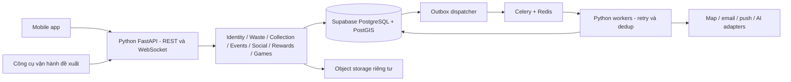

# Backend và contract API đề xuất

## Kiến trúc và ranh giới

Backend dùng **Python**, database dùng **Supabase** theo lựa chọn của chủ dự án; chưa có code runtime trong workspace. Phương án đề xuất: modular monolith **FastAPI + Pydantic**, **SQLAlchemy + psycopg** truy cập Supabase PostgreSQL/PostGIS, **Celery + Redis** cho worker, **FastAPI WebSocket** cho chat/game events. Mỗi module sở hữu use case; transaction điểm/kho/chỗ/outbox chạy trong một SQL session. [FastAPI features](https://fastapi.tiangolo.com/features/), [tích hợp Supabase](09-python-supabase.md).

Admin là nhu cầu vận hành suy ra từ các màn hình “xét duyệt”, chưa có UI admin trong trang chính. Không đưa app trực tiếp tới DB hoặc provider có secret. Mobile upload trực tiếp tới object storage qua URL giới hạn, server kiểm soát owner và finalize. QR, media, điểm và capacity đều xác thực ở server.

## Ranh giới với Supabase

Trong baseline, mobile/admin chỉ gọi API Python cho dữ liệu nghiệp vụ. Database đặt schema nghiệp vụ `app_private` ngoài danh sách schema Data API được expose; thu hồi quyền `anon`/`authenticated` với bảng và hàm nghiệp vụ. API/worker dùng DB role riêng, giới hạn grants; không phát database URL hoặc privileged key cho client. RLS không tự hiểu user JWT khi SQLAlchemy kết nối trực tiếp: authorization tại service vẫn bắt buộc. Quy định chi tiết ở [09 — Python + Supabase](09-python-supabase.md).

**Identity owner đã chốt: Python tự quản lý users/password/OTP/JWT/session/OAuth; không dùng Supabase Auth.** Supabase trong baseline là database. Storage/Realtime chỉ xem xét nếu có yêu cầu riêng sau này; không phát sinh dependency hoặc code auth thứ hai. Wire/security defaults ở `contracts/auth-policy.json`; shape API ở `contracts/core.openapi.json`.

## Module và trách nhiệm

| Module | Interface nguồn | Trách nhiệm |
|---|---|---|
| Identity | 386:7184–7390, 514:5099, 521:4735 | Email/password, OAuth, OTP, session, revoke, consent, audit |
| User/Preferences | 386:7420, 8516, 7151–7176, 8451 | Hồ sơ, sở thích, mục tiêu, theme, nhắc hằng ngày; PIN là khóa thiết bị |
| Content/Waste | 386:13263–14970, 16931–17145 | Taxonomy, vật liệu, hướng dẫn theo vùng/nguồn/phiên bản |
| Recognition | 386:14194–14379 | Upload, job nhận diện, candidates/confidence, đính chính, ghi nhận hành động |
| Collection | 386:8633, 10186; 534:48401–48690 | Geo search, giờ nhận, vật liệu, status freshness, compare, review, report/proposal moderation |
| Routing/Handover | 386:10136, 10279, 10351; 534:48774–48955 | Preview nhiều điểm, thay thế, trạng thái stop, tự báo bàn giao/xác minh |
| Events | 386:7054; 534:49034–49760 | Khám phá, lịch, đăng ký theo vai trò, giữ chỗ, vé, check-in, feedback, album, impact |
| Saved/Reminders | 386:18069; 534:49845, 49968 | Bộ sưu tập, chuyển nhiều item, lịch nhắc nhiều offset/kênh, quiet hours |
| News | 391:24796, 386:10644–10919, 17608–17978 | Biên tập, rich blocks, nguồn, reaction/comment, public metrics |
| Community | 386:7647, 7813, 15047–16188 | Post visibility, ảnh/video, cảm xúc/check-in, reaction, comment, save/share, quan hệ, moderation |
| Messaging | 386:8086, 8151, 8179, 17262 | Conversation, media, reference share, read marker, presence, block |
| Assistant | 386:8930, 8977, các Listening frame | Bot có nguồn, hội thoại tách biệt, speech transcription qua adapter |
| Rewards | 386:11010–13109, 16253, 16592, 7550 | Wallet, ledger, rule version, daily claims, level/badge, catalog/quà/voucher, redemption |
| Notifications | 386:7913, 8003, 8228–8380, 18153 | Inbox bền vững, push/email attempts, deeplink, preferences |
| Games | 386:18241–18428, 427:19392/19460, 487:19805 | Luật Sứ mệnh xanh, session, chấm đáp án, room, scheduling, award |
| Statistics | 391:25009 | Read model từ dữ kiện xác minh/khai báo, phân biệt kg/lượt, period, denominator |
| Operations | Suy ra từ duyệt và giao dịch | Moderation queue, publish nội dung, kho quà, hoàn điểm, audit, support |

## Danh tính và phân quyền

| Vai trò đề xuất | Được phép | Điều kiện bắt buộc |
|---|---|---|
| Guest | Đọc nội dung công khai, điểm thu gom, khám phá hoạt động | Không đọc PII/tin nhắn; không claim hoặc đổi quà; guest quota scan nếu cho phép là quyết định cần chốt |
| Member | Sửa dữ liệu mình, bài/tin nhắn trong quyền, claim/đăng ký | Owner/membership/visibility kiểm tra từng object, kể cả media/deeplink |
| Point operator | Xác nhận bàn giao và tình trạng điểm được giao | Scope theo point_id; không duyệt đề xuất của mình nếu policy cấm tự duyệt |
| Event organizer/check-in staff | Quản lý sự kiện được giao, check-in đúng event | Không đọc danh sách sự kiện khác; xuất dữ liệu cần audit |
| Moderator/editor | Duyệt điểm, báo cáo, nội dung theo phạm vi | Ghi lý do và trước/sau; không sửa trực tiếp wallet |
| Reward operator | Kho, fulfillment, voucher; yêu cầu refund | Refund dùng command và ledger bù; không cập nhật balance bằng tay |
| Admin | Cấu hình/role/khóa tài khoản | Strong auth, audit; không mặc định mọi nhân viên là admin |

Service/worker dùng identity riêng. OAuth dùng authorization code + PKCE cho public client, xác minh issuer/audience/nonce và binding; refresh token rotation/reuse detection theo thiết kế auth được review. Chưa chọn Google/Facebook SDK hay credential. [OAuth Security BCP RFC 9700](https://www.rfc-editor.org/rfc/rfc9700.html).

Email/password: hash mật khẩu bằng thuật toán password hashing đã review; không lưu plaintext. OTP hash, scope theo purpose, giới hạn attempts, single-use và hết hạn. Đề xuất ban đầu: TTL 5 phút, 5 lần thử/challenge, resend tối thiểu 60 giây, rate limit thêm theo user/IP/device; đây là cấu hình đề xuất, không có trong Figma. Password policy trong Figma là ít nhất 8 ký tự với chữ/số/ký tự đặc biệt; cần chốt policy sản phẩm và rà soát thực tế trước implementation.

## Quy ước HTTP chung

- Prefix `/v1`, HTTPS; API được định nghĩa bằng OpenAPI và sinh types cho app. Trong danh sách bên dưới bỏ prefix để dễ đọc.
- ID public là UUID/opaque string; thời gian ISO-8601 UTC; có `timezone` IANA ở user/event/point. Tiền không có trong scope thanh toán hiện tại; cost đổi quà là số nguyên điểm.
- List: `{items, nextCursor}`; cursor dựa `(created_at,id)` hoặc sequence, không dùng offset cho feed/message/ledger đang thay đổi. Limit mặc định 20, tối đa 100 là đề xuất.
- Error envelope: `{error:{code,message,fieldErrors?,retryable,requestId}}`. 400 sai format; 401 auth; 403 không có quyền; 404 không tồn tại hoặc không được phép biết; 409 conflict; 422 lỗi nghiệp vụ; 429 giới hạn; 503 provider tạm lỗi.
- Command có tác động điểm/kho/chỗ/đăng bài gửi `Idempotency-Key`. Scope key theo actor + operation; lưu canonical request hash và outcome. Cùng key/cùng body → outcome cũ; khác body → 409 `IDEMPOTENCY_CONFLICT`. DB unique theo business source vẫn là bảo vệ cuối cùng khi key khác.
- Tài nguyên editable có `version`; `If-Match`/expectedVersion chống ghi đè route, profile và nội dung. Server trả canonical state sau mutation.
- Media API nhận mediaId, không chấp nhận URL arbitrary. Kiểm tra ownership, MIME thật, kích thước, pixel/duration, scan nội dung/file theo loại. Chính sách dung lượng chưa có trong thiết kế; đề xuất ảnh 10 MB/20 MP, cấu hình và kiểm thử trước áp dụng.

## API theo interface

**Nguồn contract chuẩn:** [core.openapi.json](contracts/core.openapi.json) pin các operation nền/auth/sorting/moderation đã đặc tả. [Operation inventory](contracts/operation-inventory.json) liệt kê từng method/path/operationId cụ thể và SPEC packet sở hữu. Các dòng nhóm bên dưới chỉ là chỉ mục người đọc. Operation có `schemaStatus=contract_task_required` phải hoàn tất/review SPEC trước BUILD; không generate DTO trống. CI-001 đã sửa: sorting dùng duy nhất `source + itemId`, thêm `scanId` khi source=scan.

Các path là contract đề xuất, chưa phải server hoạt động. Tham số actor lấy từ session, không tin `userId` do client gửi.

| Method / path | Input chính → output | Quyền / điều kiện |
|---|---|---|
| GET `/bootstrap` | app config, taxonomy versions, flags, user summary tùy auth | Public; không lộ secret |
| POST `/auth/register` | name,email,password,consentVersion → next step/session theo policy xác minh | Rate limit; normalized email unique |
| POST `/auth/login`, `/auth/refresh`, `/auth/logout` | credentials/token → session/tokens hoặc revoke | Secure storage; không log token |
| POST `/auth/password-reset/request` | email → generic accepted | Không khác response theo tồn tại tài khoản |
| POST `/auth/password-reset/verify` | challengeId,code → resetToken ngắn hạn | Purpose binding, attempt và expiry |
| POST `/auth/password-reset/complete` | resetToken,newPassword → completed | Consume token trong transaction; revoke session theo policy |
| POST `/auth/oauth/exchange` | provider,code,codeVerifier,redirect binding → pending profile/session | Server kiểm chứng provider; explicit linking |
| GET/PATCH `/me` | displayName,birthDate?,country?,avatarMediaId → profile,version | Email mới qua flow riêng; field công khai tách riêng tư |
| POST `/me/email-change`, `/me/email-change/verify` | newEmail rồi challenge → verified email | Re-auth, unique và thông báo bảo mật |
| POST `/me/password` | currentPassword,newPassword → success | Re-auth; social-only account có nhánh riêng |
| GET `/me/sessions`; DELETE `/me/sessions/{id}` | sessions; revoke → status | Chỉ owner; invalidate refresh và gateway |
| GET/PATCH `/me/preferences` | theme,sound,haptics,timezone,notification prefs → prefs | Tùy chọn thiết bị tách tài khoản |
| PUT `/me/interests`, `/me/goals` | selected IDs → saved | Idempotent; onboarding draft merge có lựa chọn |
| GET `/me/activity` | cursor → action summaries | Private, không phải nguồn điểm |
| GET `/users/{id}`; GET `/users/{id}/posts`; GET `/me/friends` | public profile/visible posts/friends cursor → items | Không xuất email/ngày sinh/contact; ACL và block; profile của người khác không dùng GET /me |
| GET `/home` | personalized blocks, wallet summary, events, content | Lỗi provider từng block có degraded response |
| GET `/waste-categories`, `/waste-items` | q,category,material,locale,cursor → items | Public; cache theo revision |
| GET `/waste-items/{id}`, `/waste-items/{id}/instructions` | locality,revision → taxonomy, steps,sources | Nhãn hazardous và bin convention riêng |
| POST `/media/uploads`; POST `/media/uploads/{id}/complete` | purpose,type,size,checksum → upload URL/mediaId; finalize → ready | Owner, quota, validation; upload chưa finalize không attach |
| POST `/scans`; GET `/scans/{id}` | ready mediaId → 202 scanId/status; poll → candidates/instructions | Owner; bounded job/retry, có unrecognized |
| POST `/scans/{id}/corrections` | candidate/material correction,reason → correction | Không sửa nguyên bản model prediction |
| POST `/sorting-actions` | source=scan + scanId + itemId hoặc source=manual + itemId → action,evidenceStatus,award | Strict oneOf; không nhận category/material/points từ client; derive tại server |
| GET `/collection-points` | bbox hoặc lat/lng,radiusM,materials,matchMode,openAt,capacity,staffed → pins/cards | all/any được định nghĩa; limit vùng, freshness |
| GET `/collection-points/{id}` | detail, sources,status time, hours,reviews | Chỉ điểm published; private contact theo policy |
| POST `/collection-points/compare` | pointIds,origin,travelMode → comparable fields | Số điểm giới hạn config; ETA qua provider |
| GET/POST `/collection-points/{id}/reviews` | cursor / rating,body → review | Member; không cho tự tăng aggregate từ client |
| POST `/point-proposals`; PATCH `/point-proposals/{id}` | name,address,pin,mediaIds,materials,hours → draft/submitted | 1–5 ảnh theo mẫu khi submit; owner draft |
| POST `/collection-points/{id}/reports` | issueTypes,description,mediaIds,observedAt → pending | Không tự publish trạng thái chỉ vì user report |
| POST `/routes/preview` | origin,stopIds,material assignments,mode,departAt → polyline,legs,ETA,unserved | Chưa tạo bàn giao; provider timeout/fallback |
| POST `/routes`; GET/PATCH `/routes/{id}` | preview/options/order,version → route snapshot | Owner; explicit replace; invalidate stale ETA |
| GET `/routes/{id}/alternatives` | stopId,requiredMaterials → candidates,extra distance/time | Giữ các stop còn lại, chỉ điểm đủ vật liệu bắt buộc |
| POST `/routes/{id}/start`; POST `/routes/{id}/cancel` | version → active/cancelled | Owner, current state valid |
| POST `/routes/{id}/stops/{stopId}/arrive` | optional location evidence → arrived | Không tự verified; GPS accuracy ghi riêng |
| POST `/routes/{id}/stops/{stopId}/handover` | materials,quantity?,unit?,confirmation → self_reported | Không cấp kg xác minh từ số ảnh; một operation không cộng hai lần |
| GET `/events`, `/events/{id}` | city/date/topic/q/cursor → events,occurrences,roles | Published; trả server capacity/status |
| GET `/me/calendar` | start,end,timezone → saved/registered events,overlaps | Giới hạn date window; phân biệt loại quan hệ |
| POST `/events/{id}/registrations` | occurrence,role,count,contact,consent versions → registration,ticket | Capacity lock; eligibility, deadline, idempotent |
| GET `/me/registrations`; POST `/registrations/{id}/cancel` | cursor / reason → status | Owner, deadline và chỗ hoàn lại theo rule |
| GET `/me/tickets`, `/tickets/{id}` | cursor / ticket detail + QR render payload | Owner hoặc staff đúng scope |
| POST `/tickets/{id}/check-in` | QR token,staff session → attendance | Staff event scope, valid window, anti-replay |
| POST `/events/{id}/feedback` | registrationId,rating,tags,comment → feedback | Chỉ participant đủ điều kiện, unique participation |
| GET `/events/{id}/album`, `/events/{id}/impact` | cursor → media/metrics with verification | Permission/consent cho ảnh, nguồn dữ liệu impact |
| GET/POST/PATCH/DELETE `/me/event-collections[/{id}]` | name,sort → collection | Owner; xóa collection không hủy registration |
| PUT/DELETE `/me/saved-events/{eventId}` | saved state → saved | Idempotent; không tạo ticket |
| POST `/me/event-collections/{id}/move` | eventIds,targetCollectionId → membership | Transaction, toàn bộ items thuộc owner, vẫn được saved |
| GET/PUT `/me/reminders/daily` | enabled,localTime,timezone,channels → rule,nextOccurrence | Hủy/tạo lại theo rule version |
| GET/PUT `/me/event-reminders` | eventIds,offsets,channels,quietHours → rules,nextOccurrences | Nhắc trước sự kiện chưa qua; không gửi nhắc sau event start |
| GET `/articles`, `/articles/{id}` | q/topic/latest/upcoming,cursor → blocks/sources | Published; upcoming event card có entity link rõ |
| PUT/DELETE `/articles/{id}/reaction`; GET/POST `/articles/{id}/comments` | reaction/body → canonical counters | Member, moderation |
| GET `/content-metrics` | versioned public metrics → value,unit,source,asOf | Không lấy mock statistics làm số thật |
| GET/POST `/posts`; GET/PATCH/DELETE `/posts/{id}` | feed/q/cursor hoặc body,media,visibility,feeling,location → post | ACL, owned media, text sanitation; soft-delete theo policy |
| PUT/DELETE `/posts/{id}/reaction`; GET/POST `/posts/{id}/comments` | reaction/body → item/counters | Viewer được xem post; comment owner check khi sửa/xóa |
| PUT/DELETE `/me/saved-posts/{id}`; POST `/posts/{id}/shares` | target? → reference/share count | Không tạo quyền xem cho người nhận trái privacy |
| PUT/DELETE `/me/follows/{userId}`; POST/PATCH `/friendships[/{id}]` | follow hoặc request/accept/reject → relationship | Block wins; friendship accepted dùng cho friends visibility |
| PUT/DELETE `/me/blocks/{userId}`; POST `/moderation-reports` | target,reason → accepted | Không tự theo dõi; chống report spam |
| GET `/status-notes`; PUT/DELETE `/me/status-note` | text,feeling,audience → note,expiresAt | Note/mood trong chat; TTL theo policy, owner và graph ACL, không đọc expired/blocked |
| GET/POST `/conversations`; GET `/conversations/{id}` | recipient(s) → conversation | Membership, block và DM policy |
| GET/POST `/conversations/{id}/messages` | afterSequence / clientMessageId,text/media/postRef → message,sequence | Authoritative DB sequence, idempotent |
| PUT `/conversations/{id}/read` | lastReadSequence → marker | Monotonic; chỉ sequence thuộc conversation |
| POST `/assistant/conversations`; GET `/assistant/conversations/{id}` | thread → own history | Tách dữ liệu P2P |
| POST `/assistant/conversations/{id}/messages` | question,locale,context IDs → stream/job,answer,citations | Retrieval nguồn approved; quota; no secret/model prompt injection actions |
| POST `/assistant/transcriptions` | audioMediaId → transcript,status | Consent microphone, duration/quota, retention riêng |
| GET `/me/notifications`; PATCH `/me/notifications/{id}`; POST `/me/notifications/read-all` | cursor / read marker → inbox | Owner, read-all cutoff không đọc nhầm thông báo mới đến |
| PUT/DELETE `/me/push-devices/{id}` | provider token,platform → registered | Account binding; invalid token được dọn |
| GET `/me/wallet`, `/me/point-transactions` | summary / type,period,cursor → balance/lifetime/entries | Private; balance canonical |
| GET `/point-rules`, `/levels`, `/leaderboard`; GET `/me/badges` | ruleVersion/period → rules,rank,badges | Public identity minimal; opt-out policy |
| POST `/me/daily-claims` | operationId → claim,delta,balance,nextClaimAt | Server local date, unique user/date; client không gửi điểm |
| GET `/rewards`, `/rewards/{id}` | category,q,cursor → cost,stock,status | Published, cost version |
| POST `/redemptions`; GET `/me/redemptions`, `/redemptions/{id}` | rewardId,quantity,expectedCost,deliveryOption? → status,reference,balance | Wallet/inventory transaction, eligibility, idempotency |
| POST `/redemptions/{id}/cancel` | reason → cancelled/refund result | State/policy; không hoàn hai lần |
| GET `/me/statistics`, `/statistics/community` | metric,start,end,groupBy → series,unit,denominator,evidenceScope | Private/public aggregates tách; có no-data |
| GET `/games`; POST `/game-sessions` | gameId,roomId? → server question set,deadline | Không lộ answer key |
| POST `/game-sessions/{id}/answers`, `/game-sessions/{id}/finish` | questionId,assignment,sequence → result,award | Chấm ở server, thời gian server, award once |
| GET/POST `/game-rooms`; POST `/game-rooms/{id}/join|ready|leave|start` | room action → roster,state | Owner/host, capacity, session state |
| POST `/game-schedules`; GET `/me/game-schedules` | gameId,start,invitees → schedule | Chưa có UX chi tiết; cần thiết kế consent/lời mời |
| GET `/admin/review-queue`; POST `/admin/point-proposals/{id}/decision`; POST `/admin/point-reports/{id}/decision` | scope,decision,reason → reviewed version | Scoped moderator, audit, duplicate checking |
| POST/PATCH `/admin/content/*`, `/admin/events/*`, `/admin/rewards/*` | versioned content/capacity/stock changes | Editor/organizer/reward operator đúng scope; không sửa lịch sử giao dịch |
| POST `/operator/handovers/{id}/verify`; POST `/operator/redemptions/{id}/fulfill|refund` | evidence/status → verified result | Role scope, reason, idempotency; ledger service phát entry |

Các nhóm admin đã có từng method/path/operationId cụ thể trong operation-inventory.json; nhóm trong bảng không là route literal. Mỗi operation chưa có schema được gắn owner SPEC packet. Không cho BUILD operation đó trước khi contract/error/ACL/examples được review.

## Identity wire/security defaults

`contracts/auth-policy.json` là baseline kỹ thuật cụ thể: Python Identity, Argon2id, JWT RS256 có kid/iss/aud/sub/sid/jti/iat/exp, access TTL 15 phút; refresh opaque ngẫu nhiên, TTL 30 ngày, hash lưu DB, rotate một lần dưới lock/CAS và giữ hash token đã consume để phát hiện reuse. Reuse revoke cả family; client refresh single-flight. Mỗi HTTP/WS protected command kiểm session/user còn active; không chỉ decode JWT. OTP 6 số, HMAC purpose/recipient, TTL5 phút/max5 attempts/cooldown60s; password recovery atomically consumes token và revoke session families. Đây là configuration mặc định có version, không phải số liệu đo SLA. Login/refresh/session shapes đã pin trong core.openapi.json; register/recovery/OAuth có SPEC packet riêng, không thay bằng Supabase Auth.

## Contract sâu: scan và cộng điểm

`POST /scans {mediaId}` → `202 {scanId,status:"queued",pollAfterMs}`. `GET /scans/{id}` trả `{status,candidates:[{itemId,materialId,confidence}],modelVersion,instructionRevision,error?}`. Các trạng thái: `queued → processing → recognized | uncertain | unrecognized | failed`; scan hết thời hạn có thể `expired`. Không ép mọi ảnh thành một trong ba loại rác.

`POST /sorting-actions` nhận `{source:"scan",scanId,itemId}` hoặc `{source:"manual",itemId}`; response `{actionId,itemId,evidenceStatus,award:{status,points,ruleVersion,reason},walletBalance?}`. Điểm/số dư trên wire dùng decimal string; legacy `confirmedCategory`, `confirmedItemId`, `manualItemId` và mọi client-provided points đều bị từ chối. Ngưỡng confidence, điều kiện award, quota ngày và ảnh lặp là config phải chốt. Gợi ý dùng policy demo tách production: demo có nhãn mô phỏng; production không cho claim vô hạn bằng quét lại ảnh. Nếu chưa có chứng cứ bàn giao, trạng thái tối đa là user_confirmed theo policy, không hiển thị tác động verified.

Không nhận `points` hoặc `isVerified` từ client. Scan correction lưu độc lập, chỉ dùng huấn luyện sau khi có consent và review. Không cần lưu ảnh gốc vô hạn để có lịch sử scan.

## Contract sâu: ví, ledger, đổi quà

Ví có `balance` (được tiêu) và `lifetimeEarned` (tổng tích lũy đủ điều kiện lên cấp). `point_ledger` có signed delta, sourceType/sourceId/operationType/ruleVersion và immutable timestamp. Refund tạo entry bù liên kết entry gốc, không sửa hoặc xóa entry cũ. Tách hoạt động vật lý, game và điểm danh để chính sách level/leaderboard có thể giới hạn từng nguồn.

Đổi quà thực hiện trong **một DB transaction**:

1. Reserve idempotency record theo actor/operation/key và request hash. Lock resource theo thứ tự thống nhất: wallet → reward inventory → voucher nếu có.
2. Đọc reward published/eligible, giá hiện hành, số dư, quantity, tồn kho; so expectedCost với server, trả `REWARD_PRICE_CHANGED` nếu lệch.
3. Trừ balance có điều kiện `balance >= totalCost`; reserve/decrement available inventory; claim voucher row chưa dùng nếu là voucher.
4. Tạo redemption với snapshot tên/giá/rule/delivery; tạo ledger debit với unique source; ghi outbox. Commit outcome của idempotency cùng transaction.
5. Worker fulfillment xử lý sau commit. Provider thất bại rõ ràng → command refund/compensation có unique refund reference. Kết quả provider chưa biết → `needs_review`, tra cứu trước khi gửi lại.

Nhiều request cùng lúc không được âm ví hoặc bán quá tồn. Row lock giữ đến cuối transaction và có thể chặn transaction xung đột; cần lock order nhất quán, timeout và retry toàn transaction khi gặp deadlock. [PostgreSQL row-level locking](https://www.postgresql.org/docs/current/explicit-locking.html).

Trạng thái redemption: `reserved → fulfilling → fulfilled`; `reserved → cancelled → refunded` hoặc `fulfilling → failed/needs_review → refunded/fulfilled`. Chỉ cho một kết quả tài chính cuối; không tự hoàn khi provider timeout chưa rõ đã cấp quà chưa.

Daily claim: server xác định rewardDate theo timezone policy ổn định; unique `(user_id,reward_date)`; award và claim chung transaction. Không cho đổi timezone liên tục để nhận thêm. Streak reset, ngày bỏ lỡ và mức ngày 5/7 cần chốt; không tự suy từ asset rương quà.

## Contract sâu: hoạt động, vé và lịch nhắc

Saved và registration là hai quan hệ riêng. Registration giữ số chỗ bằng `participantCount`, không phải số dòng đăng ký. Event/role capacity, deadline và trạng thái được kiểm tra trong transaction khóa counter; ticket sinh sau confirmed. Nếu external approval cần thiết, trạng thái `pending` phải có reservation expiry rõ; hiện chưa có bằng chứng cần duyệt từng đăng ký nên default đề xuất confirmed ngay khi đủ điều kiện.

QR mẫu trong Figma ghi rõ không dùng quét thật. QR production chỉ chứa token opaque có chữ ký hoặc token ngẫu nhiên tra server, có expiry/version; staff đúng event thực hiện check-in, unique ticket/check-in chống replay. Link tải vé không public PII. Hủy hoạt động vô hiệu vé, cập nhật người tham gia và hủy job nhắc.

Overlap lịch: `startA < endB AND endA > startB`; lọc occurrence đã hủy. Hai activity mẫu chồng 09:00–10:00 chỉ là cảnh báo UX. Policy có cấm đăng ký trùng hay không cần chốt; backend trả conflicts, chưa mặc định cấm.

Reminder lưu offset, channel, timezone, quiet hours, ruleVersion. Mỗi delivery unique theo `(rule,targetOccurrence,offset,channel,ruleVersion)`. Job chạy phải kiểm tra lại rule enabled, event time/version, permission và đã hủy chưa. Nếu quiet hours dời giờ nhắc qua giờ bắt đầu thì bỏ nhắc hoặc gửi cảnh báo theo policy; không gửi sau khi sự kiện kết thúc. “Hiện màn hình khóa” và quyền OS không thể bảo đảm chỉ bằng setting server.

## Contract sâu: địa lý, status và route

Điểm published lưu `geography(Point,4326)`, GiST index và timezone tại địa điểm. API dùng `radiusM`, không trộn độ với mét. `ST_DWithin` trên geography nhận đơn vị mét và có thể tận dụng index; ETA và đường đi vẫn cần routing provider. [PostGIS ST_DWithin](https://postgis.net/docs/ST_DWithin.html).

`acceptedMaterials` là capability; `point_status_observations` là quan sát tình trạng theo vật liệu/nguồn/time. Khi lọc “vẫn nhận đủ nhựa và giấy”, cần `matchMode=all` trên capability và status đủ mới; mặc định all hay any phải hiện trong UX. “Đang mở cửa” xét timezone, lịch tuần và ngoại lệ nghỉ lễ; unknown khác closed.

Proposal/report có draft/submitted/under_review/approved/rejected và lý do. Chỉ approve mới làm thay đổi public entity; concurrency version ngăn moderator ghi đè. Lưu lịch sử, phát hiện trùng địa chỉ/tọa độ, không tự đưa địa chỉ người dùng nhập thành điểm tin cậy.

Route giữ snapshot leg và provider timestamp, ordered stops, materials từng stop, travelMode, departAt, version. Reorder/replace tính lại route; server báo vật liệu chưa có điểm nhận. Không gọi kế hoạch nhiều điểm là tối ưu toàn cục nếu chỉ theo thứ tự người dùng; tối ưu tự động là spike riêng. `arrived → handover_self_reported → verified/rejected` không đồng nghĩa điểm thưởng tự động.

## Realtime, bot, game và moderation

WebSocket envelope `{eventId,type,conversationId?,sequence?,occurredAt,payload}`. Sự kiện `message.created`, `message.receipt`, `typing.changed`, `conversation.read`, `room.member_changed`, `game.started`, `game.result`. Auth ở connect và mỗi join/command; revoke ngắt hoặc chặn token ngay. Persist message trước broadcast, reconnect dùng `afterSequence`. Typing/presence ephemeral, có TTL. Call/video cần signaling, media relay, call lifecycle, permission và abuse controls riêng; chỉ icon Figma chưa đủ để ước lượng như chat text.

Bot truy xuất hướng dẫn có nguồn/phiên bản theo vùng, trả citations, từ chối bịa khi thiếu nguồn; không dùng số “11 tấn/ngày” trong mock làm kiến thức thật. Tách prompt/user text khỏi quyền command; bot không được trực tiếp ghi ledger, duyệt điểm hoặc đăng nội dung. Ngân sách/token quota, timeout/circuit breaker và retention phải cấu hình. Voice frame Start/Stop chỉ chứng minh tương tác microphone, chưa chứng minh có yêu cầu full voice assistant liên tục.

Game server tạo question set/seed/deadline, nhận thao tác và chấm theo rule version; một completed session chỉ award một lần. Room lobby xử lý disconnect/host rời/capacity. Chỉ **Sứ mệnh xanh** có các trạng thái chơi/kết quả đủ rõ; XO, Đua vịt, lịch chơi và 5 người tham gia cần thiết kế luật chi tiết ở backlog, không giả lập đã đặc tả xong.

Posts/comments/reviews có report/block và moderation state. Visibility áp dụng cả feed/search/share/notification/media. Block có ưu tiên cao hơn friendship/follow. Thông báo không được tiết lộ nội dung của post đã đổi riêng tư hoặc bị xóa. Call, friend model và moderation UX chưa hoàn chỉnh được ghi ở quyết định mở.

## Job, độ tin cậy và vận hành

| Job | Trigger | Dedup/điều kiện chạy lại | Xử lý lỗi |
|---|---|---|---|
| recognize_scan | Media finalize + create scan | scanId + modelVersion; chỉ chuyển hợp lệ | Timeout có giới hạn; failed cho retry hữu hạn |
| media_validate/thumbnail/cleanup | Upload/retention | mediaId + revision | Quarantine file invalid; xóa orphan sau grace period |
| send_otp | Challenge created | challengeId + delivery attempt | Cooldown; OTP mới vô hiệu challenge cũ theo policy |
| send_notification | Outbox event | notificationId/channel/target | Backoff, invalid token disable; DB inbox vẫn còn |
| event_reminder/daily_reminder | Scheduler | rule/target/offset/channel/version | Kiểm tra stale schedule trước send |
| reward_fulfillment | Redemption reserved | redemptionId; provider idempotency nếu có | unknown → reconcile, không gửi mù |
| recompute_statistics/leaderboard | Domain events + periodic repair | user/date/version | Upsert projection, reconcile từ fact/ledger |
| rebuild_search/content_cache | Published content change | entityId/revision | Retry; trả bản approved gần nhất có version |
| reconcile_wallet/inventory/outbox | Scheduled operation | batch checkpoint | Alert khi lệch, không tự sửa bằng update balance |

Outbox được ghi chung transaction với dữ liệu nghiệp vụ; dispatcher có thể giao lặp, consumer có dedup trong DB. Queue không bảo đảm side effect đúng một lần nếu provider không hỗ trợ. Job phải có thể retry mà không đổi kết quả cuối ngoài ý muốn. [Celery với Redis](https://docs.celeryq.dev/en/stable/getting-started/backends-and-brokers/redis.html).

Log có requestId/operationId/entityId đã giảm PII; không có password/OTP/refresh token/QR secret/ảnh gốc. Metric: p95 latency, error theo use case, job age/retry, scan latency/uncertain rate, OTP delivery, redemption fail/refund, stale point status, socket reconnect, reminder duplicates. Audit riêng cho role/moderation/điểm/kho.

Mục tiêu pilot đề xuất để đo, chưa phải năng lực đã đạt: read API p95 < 500 ms trong tải mục tiêu; mutation nội bộ < 1 s khi không gọi provider; scan async có status ngay và ngân sách xử lý 15 s trước nhánh chậm; inbox/ledger không mất khi queue downtime; backup phục hồi thử với mục tiêu RPO ≤ 24 h/RTO ≤ 4 h. Chốt tải, ngân sách và SLA trước sizing.

Local/staging/production tách DB, bucket, key và provider projects. Secret ngoài repository; migration qua pipeline; deploy backward-compatible trước app store rollout. Liveness/readiness và graceful shutdown; rollback app dùng feature flag, rollback DB ưu tiên forward fix có backup. Không có hạ tầng nào đã được tạo trong lần phân tích này.
