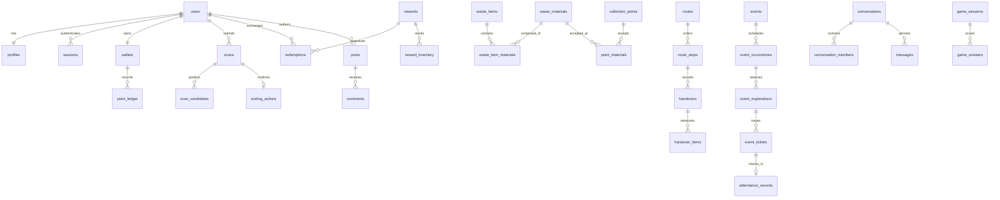

# Database đề xuất và từ điển dữ liệu

## Nền tảng đã chọn: Supabase PostgreSQL

Database triển khai trên **Supabase PostgreSQL/PostGIS**, schema ứng dụng `app_private` không expose Data API. **Python Identity đã được chủ dự án chọn**, sở hữu users/password/OTP/JWT/session. Không dùng `auth.users`, Supabase Auth SDK hoặc token do Supabase phát cho app. Runtime/grants/RLS theo [access matrix](contracts/access-matrix.json); Python object ACL vẫn bắt buộc vì direct SQL không tự có user JWT context.

Migrations SQL trong `supabase/migrations` là nguồn schema chuẩn; SQLAlchemy models ánh xạ schema, không tự tạo/cập nhật bảng production. Không chạy thêm chuỗi Alembic song song. PostGIS, partial indexes, constraints và grants đều đi qua migration có review. Pool runtime và migration connection tách riêng; ledger/inventory/capacity/outbox dùng một SQL transaction.

Thay owner identity là thay đổi kiến trúc cần yêu cầu mới, không phải nhánh đang chờ agent tự quyết. Các task hiện tại chỉ triển khai Python Identity; tuyệt đối không duy trì hai kho password/session.

## Quy ước và phạm vi

Đây là mô hình quan hệ logic phục vụ toàn bộ interface GreenSteps/BlueSteps, **chưa phải schema hiện hữu hoặc migration có thể chạy**. Bảng được chia theo domain để triển khai theo giai đoạn; không cần tạo tất cả trong sprint đầu. Các FK/unique/check/index ghi ở đây phải được chuyển thành migration có kiểm thử ở bước implementation.

Mặc định: PK `id uuid`; timestamps `timestamptz`; `created_at`, `updated_at`; owner FK về `users.id`; enum/check cho state; `version int` ở tài nguyên mutable. Bảng join dùng composite PK thay `id` nếu phù hợp. `text` có giới hạn độ dài tại validation và check với trường nhạy về quota. Lưu UTC, timezone IANA riêng; ngày điểm danh dùng `date` đã tính theo policy. Điểm là `bigint`, quantity/khối lượng là `numeric` và có unit; không dùng floating point cho số dư.

`?` = nullable; FK được ghi bằng `→`. Tên bảng trong catalog interface là những bảng trực tiếp liên quan, không phải toàn bộ join hỗ trợ. Không lưu ảnh/audio/base64 trong PostgreSQL; chỉ lưu metadata và object key.

## Quan hệ chính

Mermaid chỉ trình bày quan hệ cốt lõi. Các bảng còn lại và điều kiện integrity có trong từ điển bên dưới; không suy ERD rút gọn là toàn schema.

## Identity, hồ sơ, sở thích

| Bảng | Trường chính và quan hệ | Integrity/index quan trọng |
|---|---|---|
| `users` | email_normalized text?, status, email_verified_at?, timezone, deleted_at? | Unique partial email khi còn active; enum active/locked/deleting/deleted |
| `profiles` | user_id → users PK, display_name, avatar_media_id? → media_assets, birth_date?, country_code?, bio?, public_visibility | Tách profile công khai khỏi email/phone; không public ngày sinh mặc định |
| `auth_identities` | user_id, provider, provider_subject?, password_hash?, password_updated_at? | Unique(provider,provider_subject); password chỉ identity local; không gộp bằng email chưa verified |
| `auth_challenges` | user_id?, recipient_hash, purpose, code_hmac, reset_token_hash?, expires_at, attempt_count, max_attempts, consumed_at?, resend_after | Index recipient_hash/purpose/time; atomic consume; không lưu OTP/password reset token dạng rõ |
| `sessions` | user_id, token_family_id, device_label, platform, created_at,last_seen_at,expires_at,revoked_at? | Family lifecycle là session; JWT sid trỏ session; owner revoke; active lookup cho protected requests |
| `refresh_tokens` | session_id → sessions,token_hash,parent_token_id?,issued_at,expires_at,consumed_at?,revoked_at? | Unique token_hash và parent_token_id khi có; consumed hash giữ tới family expiry; atomic rotate/CAS; reuse revoke family; không overwrite hash token cũ |
| `consent_records` | user_id, purpose, policy_version, accepted_at, withdrawn_at?, context_type?, context_id? | Lịch sử append-only; purpose gồm terms/event_contact/AI_media_training nếu chọn |
| `user_preferences` | user_id PK, theme, sound_enabled, haptics_enabled, notification_config jsonb, locale, version | theme system/light/dark; JSONB chỉ cài đặt linh hoạt, không chứa ledger |
| `user_interests` | user_id, topic_key, selected_at | PK(user_id,topic_key); keys từ config approved |
| `user_goals` | user_id, goal_key, status, starts_on, ends_on? | Một goal khởi đầu active nếu policy single-select; lưu lịch sử khi đổi |
| `roles` | code,description,permission_keys text[],version | Unique code; các role editor/moderator/reward_operator/admin có quyền rõ; không nhận role từ client |
| `user_roles` | user_id,role_id → roles,granted_by,granted_at,expires_at?,revoked_at? | Composite hoặc partial unique active(user,role); cấp/thu hồi có audit; scope điểm/event dùng assignment riêng |

PIN khóa ứng dụng **không có bảng backend** trong phương án cơ sở. Lưu verifier/bí mật trong bảo mật OS theo thiết kế app lock, có timeout/attempt lock và re-auth; không dùng PIN 6 số thay password server. Nếu yêu cầu đồng bộ app-lock nhiều thiết bị thì phải đặc tả riêng.

## Hạ tầng dữ liệu dùng chung

| Bảng | Trường chính và quan hệ | Integrity/index quan trọng |
|---|---|---|
| `media_assets` | owner_id, purpose, object_key, content_type, size_bytes, checksum, width?, height?, duration_ms?, state, retention_until?, deleted_at? | Unique object_key; state initiated/uploaded/ready/quarantined/deleted; owner/purpose; private object |
| `knowledge_sources` | title, canonical_url?, publisher, locality?, source_date?, retrieved_at, approval_state, revision, checksum | Approved-only trong hướng dẫn/bot; không tự coi URL là nguồn đúng |
| `audit_logs` | actor_id?, actor_role, action, target_type,target_id, request_id, reason?, safe_before_after jsonb, occurred_at | Append-only, index target/time và actor/time; không lưu secret hoặc full PII snapshot |
| `outbox_events` | aggregate_type,aggregate_id, event_type, payload_version,payload jsonb, occurred_at,published_at?,attempt_count | Index pending theo occurred_at; event id unique; payload tối thiểu |
| `idempotency_records` | actor_id,operation,key,request_hash,status,response_ref?,response_safe jsonb?,expires_at | Unique(actor_id,operation,key); cùng transaction với effect; TTL không thay business unique |
| `feature_flags` | key, rollout_rules jsonb, enabled, version | Unique key; server giải quyết flag; không gửi secret targeting |

Quan hệ media → post/report/message lưu ở join có FK; object không được attach trước ready. Xóa asset kiểm tra reference và retention; xóa storage sau commit bằng job, không xóa trước rồi mới ghi DB.

## Taxonomy rác, nhận diện, hành động

| Bảng | Trường chính và quan hệ | Integrity/index quan trọng |
|---|---|---|
| `waste_categories` | code,name,description,sort_order,active | Unique code; nhóm hữu cơ/tái chế/còn lại không thay material/hazard |
| `waste_materials` | code,name,hazard_class,accepted_handling_code,active | Unique code; pin/điện tử/y tế có nhãn cần quy trình chuyên biệt |
| `waste_items` | category_id → waste_categories,code,name,aliases text[],image_id?,description,revision,published_at? | Unique code; search aliases/name, locale sau nếu cần |
| `waste_item_materials` | item_id → waste_items, material_id → waste_materials, is_primary | Composite PK; vật phẩm hỗn hợp có nhiều material; không ép sai một loại |
| `waste_instructions` | item_id?,material_id?,locality_code,locale,steps jsonb,bin_label?,source_id → knowledge_sources,revision,effective_from,effective_until? | Ít nhất một item/material; unique scope+revision; một bản hiệu lực được chọn có quy tắc rõ |
| `scans` | user_id,media_id → media_assets,status,model_version,started_at?,completed_at?,error_code?,idempotency_ref? | Index user/time; status state machine; không có points do client gửi |
| `scan_candidates` | scan_id → scans,item_id?,material_id?,rank,confidence numeric,raw_label | Unique(scan_id,rank); 0≤confidence≤1; model raw output giới hạn/đã sanitize |
| `scan_corrections` | scan_id,user_id,item_id?,material_id?,reason,review_state | Không overwrite candidate; owner scan check; index review_state/time |
| `sorting_actions` | user_id,scan_id? → scans,item_id?,material_id?,source,confirmed_at,evidence_status,rule_version,eligibility_reason | Unique partial scan_id khi không null; manual action có operation unique; evidence self_reported/user_confirmed/verified/rejected |

Hướng dẫn màu thùng thuộc địa phương/quy trình có nguồn, không là thuộc tính cố định toàn cầu của `waste_categories`. Một ảnh có nhiều candidates; chỉ một sorting_action đủ điều kiện/scan theo phương án ban đầu. Nhiều vật thể trong một ảnh cần sản phẩm chốt trước khi cho nhiều award.

## Wallet, ledger, reward

| Bảng | Trường chính và quan hệ | Integrity/index quan trọng |
|---|---|---|
| `wallets` | user_id unique, balance bigint, lifetime_earned bigint, version | CHECK balance≥0, lifetime_earned≥0; balance cache được cập nhật cùng ledger trong transaction |
| `point_rules` | code,version,source_type,config jsonb,effective_from,effective_until?,state | Unique(code,version); immutable sau active; lưu rule used trong entry |
| `point_ledger` | wallet_id,delta bigint,entry_kind,source_type,source_id,rule_id?,reverses_entry_id? → point_ledger,created_at,balance_after | CHECK delta≠0; unique(wallet_id,source_type,source_id,entry_kind); index(wallet_id,created_at,id); không UPDATE/DELETE nghiệp vụ |
| `daily_claims` | user_id,reward_date date,timezone_used,streak_day,awarded_points,ledger_entry_id → point_ledger | Unique(user_id,reward_date); positive award; claim+ledger atomic |
| `level_definitions` | version,level_no,label,min_eligible_points,badge_media_id? | Unique(version,level_no); thresholds tăng dần do publish validation |
| `badges` | code,name,criteria_rule_id?,image_id?,version,state | Unique(code,version); không tự cấp từ client |
| `user_badges` | user_id,badge_id,awarded_at,source_type,source_id | Unique(user_id,badge_id) nếu badge chỉ cấp một lần |
| `rewards` | code,name,description,category,reward_type,cost_points,version,state,valid_from?,valid_until?,fulfillment_config jsonb | cost>0; state draft/published/paused/retired; không sửa snapshot redemption cũ |
| `reward_inventory` | reward_id,stock_scope,on_hand int,reserved int,version | Unique(reward_id,stock_scope); 0≤reserved≤on_hand; available=on_hand-reserved |
| `reward_vouchers` | reward_id,encrypted_code,code_fingerprint,expires_at,assigned_redemption_id?,state | Unique fingerprint và assigned_redemption_id khi assigned; encrypted code không xuất qua list public |
| `redemptions` | user_id,reward_id,quantity,unit_cost_snapshot,total_cost,status,inventory_id,voucher_id?,recipient_snapshot?,original_debit_id,fulfillment_ref? | quantity>0,total_cost=quantity×unit_cost; index user/time,status/time; recipient fields tối thiểu cho phương thức đã chốt |
| `redemption_events` | redemption_id,from_state,to_state,actor_id?,reason?,provider_ref?,occurred_at | Append-only; unique provider event nếu webhook; state transition atomic |

Nguồn ledger có dạng polymorphic vì scan/game/claim/handover khác bảng; **không có FK tự động** từ `(source_type,source_id)` tới nhiều bảng. Service kiểm tra source trong cùng transaction, chỉ domain service được insert; có thể thêm typed award table/FK khi triển khai để tăng enforcement. Không tuyên bố polymorphic reference đã được DB kiểm soát đầy đủ.

Earn, spend, refund, reversal là `entry_kind` phân biệt; một debit có tối đa một full refund trong phương án đầu, unique partial trên `reverses_entry_id` cho refund. Nếu partial refund được yêu cầu, dùng refund operation riêng với tổng refund không vượt debit, chưa mặc định hỗ trợ. `lifetime_earned` không tăng do refund quà; fraud reversal có chính sách điều chỉnh level rõ.

## Điểm thu gom, hành trình, bàn giao

| Bảng | Trường chính và quan hệ | Integrity/index quan trọng |
|---|---|---|
| `collection_points` | name,address,location geography(Point,4326),timezone,contact_phone?,website?,status,staffed,entry_instructions,approved_by?,published_at?,version | GiST(location); index published/status; phone/website được duyệt |
| `point_materials` | point_id,material_id,acceptance_rule?,enabled | PK(point_id,material_id); capability khác capacity observation |
| `point_opening_hours` | point_id,weekday?,local_date_override?,opens_at?,closes_at?,is_closed,is_24h | Phân biệt unknown; giờ qua nửa đêm có quy ước; override ưu tiên tuần |
| `point_status_observations` | point_id,material_id?,capacity_state,source_type,source_actor_id?,observed_at,expires_at,verification_state | Index(point_id,material_id,observed_at DESC); enum available/full/paused/unknown |
| `point_proposals` | submitted_by,name,address,proposed_location,materials jsonb,hours_text?,media_ids via join?,state,reviewed_by?,review_reason?,published_point_id? | Draft thuộc owner; khi approve chuẩn hóa vào point_materials/hours; không dùng JSONB proposal làm canonical public point |
| `point_proposal_media` | proposal_id → point_proposals,media_id → media_assets,sort_order | Composite PK; 1–5 ảnh khi submit do command kiểm tra |
| `point_reports` | point_id,reported_by,issue_types text[],description,observed_at,state,reviewed_by?,resolution?,status_observation_id? | Index state/time,point/time; approve có thể tạo observation, không ghi đè lịch sử |
| `point_report_media` | report_id,media_id,sort_order | Composite PK; ready media, quyền owner |
| `point_reviews` | point_id,user_id,rating smallint,body,moderation_state | 1≤rating≤5; unique user/point nếu một review editable; aggregate từ review hợp lệ |
| `point_operator_assignments` | point_id,user_id,role,active_from,active_until? | Scope xác minh/hỗ trợ, unique active assignment |
| `routes` | user_id,origin geography(Point,4326),mode,depart_at,status,provider,provider_computed_at,polyline?,total_distance_m,total_duration_s,version | Khoảng cách/thời gian≥0; owner/time; không lưu từng GPS tick nếu không cần |
| `route_stops` | route_id,point_id,position,point_snapshot jsonb,status,arrived_at?,completed_at? | Unique(route_id,position), stable stopId; reorder trong transaction với constraint deferrable hoặc order key |
| `route_stop_materials` | stop_id,material_id,planned_quantity?,unit? | PK(stop_id,material_id); quantity và unit đồng thời có/không |
| `handovers` | user_id,stop_id?,point_id,source,status,declared_at,verified_at?,verifier_id?,verification_ref? | Self_reported/verified/rejected; business source/operation unique, không cấm mọi lần quay lại cùng điểm |
| `handover_items` | handover_id,material_id,declared_quantity?,verified_quantity?,unit,measurement_source | quantity≥0; kg/g/item tách unit; không gộp item với kg |
| `handover_verifications` | handover_id,verifier_id,method,evidence_media_id?,decision,reason?,created_at | Append audit; scope operator check, chống xác minh lặp cùng operation |

`point_proposals.materials` chỉ là payload nháp có schema/version, không phải nguồn query capability sau published. Ảnh proposal/report dùng join riêng; không lưu mảng mediaId không có FK trong schema cuối. Status public được chọn từ observation phù hợp và chưa hết hạn, có ưu tiên operator/moderator theo policy được công bố.

## Hoạt động, vé, bộ sưu tập và reminder

| Bảng | Trường chính và quan hệ | Integrity/index quan trọng |
|---|---|---|
| `events` | organizer_id,title,description,topic,venue,address,location?,target_audience,preparation,safety_requirements,state,version | Chủ đề/độ tuổi người hưởng lợi khác min_age người đăng ký; published index |
| `event_occurrences` | event_id,starts_at,ends_at,timezone,checkin_opens_at,registration_deadline,capacity,reserved_count,status,version | starts<ends; 0≤reserved_count≤capacity; index(starts_at,status); reschedule giữ history/version |
| `event_roles` | event_id,name,description,min_age?,active | Role eligibility khác target_audience; không tin label client |
| `event_role_slots` | occurrence_id,role_id,capacity,reserved_count | PK(occurrence_id,role_id); counters cùng transaction với occurrence |
| `event_staff_assignments` | event_id,user_id,role,active_from,active_until? | Scope organizer/check-in; không toàn quyền mọi event |
| `event_registrations` | user_id,occurrence_id,role_id,participant_count,contact_name,phone,email_snapshot,consent_refs,status,registered_at,cancelled_at? | participant_count>0; unique active(user,occurrence) theo policy đề xuất; contact private; reserve đúng count |
| `event_tickets` | registration_id,ticket_no,token_hash,token_version,expires_at,status,participant_index? | Unique ticket_no/token_hash; một vé nhóm hay từng người cần chốt; không để token rõ trong log |
| `attendance_records` | ticket_id,checked_in_by,checked_in_at,method,people_checked_in | Unique ticket_id khi vé dùng một lần; count≤registration participant_count, rule vé nhóm cần xác nhận |
| `event_feedback` | registration_id,user_id,rating,tags text[],comment,submitted_at | Unique registration_id; 1≤rating≤5; chỉ đủ điều kiện tham gia |
| `event_media` | event_id,media_id,uploaded_by,visibility,consent_ref?,sort_order | Composite PK hoặc id; không tự public ảnh người tham gia |
| `event_impact_metrics` | event_id,occurrence_id?,metric_code,value,unit,verification_state,source_ref,verified_by?,as_of | Số trẻ/tình nguyện viên/góc phân loại tách metric; labeled illustrative không aggregate verified |
| `event_collections` | user_id,name,sort_order,version | Owner, tên normalized unique theo user nếu chọn; không liên quan đăng ký |
| `saved_events` | user_id,event_id,saved_at | PK(user_id,event_id); tách saved khỏi collection |
| `collection_events` | collection_id,event_id,added_at | PK(collection_id,event_id); service đảm bảo owner có saved_events; move atomic |
| `reminder_rules` | user_id,kind,enabled,timezone,local_time?,offsets_minutes int[],channels text[],quiet_start?,quiet_end?,version | kind daily/event/game; positive offsets theo policy, unique normalized; không nhét push token vào rule |
| `event_reminder_targets` | rule_id,event_id,occurrence_id | Composite PK; chỉ target hợp lệ; reschedule tăng generation/version |

Thiết kế chưa xác định vé nhóm hay vé cá nhân. Kế hoạch cơ sở có thể phát một QR/registration và check-in cả nhóm một lần, nhưng không khóa implementation trước khi chốt việc vào cửa từng người. Trường `participant_index` và `people_checked_in` là nơi cần hoàn thiện constraint theo quyết định đó.

## Biên tập, cộng đồng và quan hệ

| Bảng | Trường chính và quan hệ | Integrity/index quan trọng |
|---|---|---|
| `articles` | slug,title,summary,cover_media_id,author_id?,topic,state,published_at?,revision | Unique slug; published/time index; không render HTML arbitrary |
| `article_blocks` | article_id,position,block_type,payload jsonb | Unique(article_id,position); schema block type, safe links/mediaIds |
| `article_sources` | article_id,source_id → knowledge_sources,claim_ref? | Composite PK; source support cho nội dung/số liệu |
| `article_reactions` | article_id,user_id,reaction_type | Unique(article_id,user_id,reaction_type) hoặc một type/user theo policy |
| `article_comments` | article_id,user_id,parent_id?,body,status | Index article/time; parent cùng article, depth limit |
| `public_metrics` | code,value,unit,region,as_of,source_id,revision,approval_state | Unique(code,region,revision); không dùng số global làm thống kê cá nhân |
| `posts` | author_id,body,visibility,feeling_code?,place_ref?,moderation_state,published_at?,deleted_at?,version | Index author/time,feed eligible/time; enum public/friends/private |
| `post_media` | post_id,media_id,position | Composite PK; unique(post_id,position); media ACL kế thừa post |
| `comments` | post_id,author_id,parent_id?,body,state,deleted_at? | Index(post_id,created_at,id); parent cùng post; owner deletion rules |
| `reactions` | post_id,user_id,type,created_at | Unique(post_id,user_id,type); có thể đổi thành unique(post,user) nếu một reaction |
| `saved_posts` | user_id,post_id,saved_at | PK(user_id,post_id); lưu không vượt quyền xem |
| `post_shares` | post_id,shared_by,conversation_id?,channel,created_at | Share reference, không nhân bản private content thành public |
| `follows` | follower_id,followed_id,created_at | Composite PK; check follower≠followed; block thắng follow |
| `friendships` | user_low_id,user_high_id,requested_by,status,requested_at,accepted_at? | Unique canonical pair, low<high; requested_by thuộc pair; trạng thái pending/accepted/rejected/removed |
| `user_blocks` | blocker_id,blocked_id,created_at | Composite PK, check ≠; indexes hai chiều cho ACL |
| `user_status_notes` | user_id,text,feeling_code?,audience,expires_at,deleted_at?,version | Một note active/user theo policy; TTL server, scope friends/followers cần chốt; index expires_at |
| `moderation_reports` | reporter_id,target_type,target_id,reason,state,assigned_to?,resolution? | Target polymorphic kiểm tra tại service; duplicate/throttle; không tự làm mất nội dung theo 1 report |

Mô hình có cả follows và friendships để hỗ trợ nhãn “Theo dõi” cùng privacy “Bạn bè” trong thiết kế; đây là đề xuất cần chốt. Nếu chọn bạn bè = mutual follow, bỏ bảng friendship và viết lại ACL/API rõ ràng trước build. Không giữ cả hai khái niệm trong UX mà không có định nghĩa.

## Tin nhắn, bot, thông báo

| Bảng | Trường chính và quan hệ | Integrity/index quan trọng |
|---|---|---|
| `conversations` | kind,last_sequence bigint,last_message_at,created_by,direct_pair_key? | Unique direct_pair_key với DM; group rules nếu có cần đặc tả |
| `conversation_members` | conversation_id,user_id,joined_at,left_at?,last_read_sequence,role | Composite PK; read marker không giảm và ≤last_sequence |
| `messages` | conversation_id,sender_id,sequence,client_message_id,type,text?,post_ref_id?,created_at,edited_at?,deleted_at? | Unique(conversation_id,sequence), unique(sender_id,client_message_id); index convo/sequence |
| `message_media` | message_id,media_id,position | Composite PK; member-only signed URL |
| `assistant_threads` | user_id,title?,locale,created_at,retention_until? | Owner/time; độc lập conversation P2P |
| `assistant_messages` | thread_id,role,content,source_refs jsonb,model_version?,status,request_id,token_usage? | Unique request_id cho command; nguồn FK có thể normalize join khi cần; quota accounting |
| `notifications` | recipient_id,type,entity_type,entity_id,payload_safe jsonb,occurred_at,read_at?,event_id | Unique(recipient_id,event_id,type); index(recipient_id,occurred_at,id), partial unread |
| `notification_deliveries` | notification_id?,rule_id?,target_occurrence_id?,offset_minutes?,channel,device_id?,generation,dedup_key,state,provider_ref?,scheduled_at,sent_at?,attempts | Unique dedup_key; index scheduled pending; inbox/push có outcome riêng |
| `push_devices` | user_id,device_installation_id,provider,encrypted_token,token_fingerprint,platform,last_seen_at,disabled_at? | Unique installation/provider; token chuyển account phải rebind; không gửi sau logout |

Presence/typing lưu Redis TTL, không cần ghi mỗi heartbeat vào DB. Audio transcription dùng media_assets purpose riêng; lịch sử bot lưu theo retention đã thông báo, không dùng toàn bộ chat riêng làm knowledge source.

## Game và read model

| Bảng | Trường chính và quan hệ | Integrity/index quan trọng |
|---|---|---|
| `games` | code,title,game_type,rules_version,rules jsonb,state | Unique(code,rules_version); chỉ publish game đủ luật |
| `game_questions` | game_id,prompt,item_id?,difficulty,revision,active | Server-owned question bank; không gửi answer key |
| `game_options` | question_id,option_key,label,correct_target?,sort_order | Unique(question_id,option_key); correct_target không xuất API chơi |
| `game_sessions` | game_id,user_id,room_id?,seed,started_at,deadline_at,status,score,completed_at?,award_ledger_id? | Server score; one award reference unique; state machine |
| `game_answers` | session_id,question_id,answer_payload jsonb,sequence,received_at,is_correct,score_delta | Unique(session_id,question_id) theo one-attempt policy; retry cùng sequence không cộng lại |
| `game_rooms` | game_id,host_id,join_code_hash,capacity,state,starts_at?,version | Unique active join code hash; chỉ host start; capacity>0 |
| `game_room_members` | room_id,user_id,state,joined_at,last_seen_at? | Composite PK; roster/capacity transaction; disconnect timeout |
| `game_schedules` | game_id,created_by,starts_at,timezone,status,room_id? | Index user/time; không giả định game scheduling đã có UX hoàn chỉnh |
| `game_schedule_invites` | schedule_id,invitee_id,state,responded_at? | Composite PK; consent/block; reminder có dedup riêng |
| `daily_user_stats` | user_id,local_date,timezone_version,metric_code,evidence_scope,value,unit,source_watermark | PK(user,date,timezone_version,metric,evidence_scope); rebuildable projection |

## Chỉ mục và truy vấn theo màn hình

| Truy vấn | Index/chiến lược | Lưu ý |
|---|---|---|
| Điểm quanh vị trí + vật liệu | GiST collection_points.location; point_materials(material_id,point_id); status theo point/material/time | Dùng ST_DWithin geography mét, sau đó order distance; đường đi/ETA không dùng khoảng cách thẳng |
| Tìm hướng dẫn theo tên | GIN full-text hoặc trigram với unaccent phù hợp tiếng Việt; waste_items code/name aliases | Migration extension và normalization cần benchmark; chưa chọn search engine riêng |
| Lịch tháng/tuần | event_occurrences(starts_at,ends_at,status), registrations(user_id,occurrence_id), saved_events(user_id,event_id) | Truy vấn overlap theo UTC từ local boundary; không lấy mọi event rồi lọc app |
| Feed | posts(published_at DESC,id DESC) partial published/public; author/time; friendship indexes | Friends ACL kiểm tra trước pagination; không lọc private sau khi đã paginate gây rỗng bất thường |
| Chat | messages(conversation_id,sequence); members(user_id,conversation_id) | Counter sequence atomic; cursor replay, không order chỉ theo timestamp |
| Lịch sử ví | point_ledger(wallet_id,created_at DESC,id DESC) | Không group cả lịch sử mỗi lần Home; summary canonical hoặc projection |
| Hàng duyệt | proposals/reports(state,created_at,id) | Claim work/version ngăn xử lý hai lần |
| Job reminder | deliveries(state,scheduled_at) partial pending + unique dedup_key | Recompute khi event hoặc rule thay đổi |

## Transaction và invariant phải thành test

1. `wallet.balance = SUM(ledger.delta)` trong cùng phạm vi ví, không âm. `lifetime_earned` theo eligible earning/reversal policy, không bằng tổng absolute delta. Reconcile định kỳ cảnh báo, mọi sửa bằng entry bù.
2. Một nguồn nghiệp vụ chỉ tạo một award cùng loại dù khác idempotency key. Daily claim unique ngày. Game completed session không award hai lần.
3. Reward `reserved ≤ on_hand`; fulfill giảm cả on_hand và reserved, cancel reservation chỉ giảm reserved; refund ví không tự tăng kho nếu quà vật lý đã giao. Voucher chỉ gán một redemption.
4. Event `reserved_count` bằng tổng participant_count các registration giữ chỗ; cancel giảm một lần; check-in không tăng capacity. Occurrence và role capacity được khóa theo thứ tự cố định.
5. Saved membership thuộc đúng user; chuyển collection không xóa saved hoặc registration. Một operation batch move atomic.
6. Ticket check-in đúng event, trong cửa sổ, không cancelled/used; QR không thành authorization cho toàn tài khoản.
7. Message sender là member hợp lệ; privacy áp dụng cho referenced post/media tại thời điểm đọc, không chỉ gửi.
8. Published point chỉ hình thành từ source approved; user report không trực tiếp overwrite point. Verified handover cần operator assignment hợp lệ.
9. Stats kg chỉ cộng measurement cùng unit đã chuẩn hóa, không từ ảnh hoặc lượt scan. Verified và self-reported có series riêng.
10. Ledger, idempotency outcome và outbox được commit atomically. Worker retry không cần giả định queue giao đúng một lần.

## Retention, xóa dữ liệu và phát triển schema

Đề xuất retention ban đầu phải được chủ sản phẩm duyệt theo nhu cầu thực tế: ảnh scan 30 ngày nếu không được giữ cho lịch sử/consent riêng; upload orphan 24–72 giờ; challenge hết hạn được dọn sau cửa sổ hỗ trợ; raw audio ngắn hơn transcript; vị trí precise chỉ dùng route cần thiết. Đây là cấu hình dự kiến, không phải kết luận pháp lý hoặc policy đã tồn tại.

Xóa tài khoản là workflow: khóa đăng nhập/revoke → hủy job và device binding → xử lý bài/nhắn/media theo policy → pseudonymize dữ liệu giao dịch phải giữ theo mục đích vận hành đã chốt → xóa PII/storage → ghi completion. Không cascade xóa ledger làm mất đối soát. Read API không lộ người đã xóa. Lịch trình xóa backup và giới hạn khôi phục phải được ghi trong policy trước pilot.

Migration theo expand/backfill/validate/contract, phục vụ app cũ còn trên thiết bị. Seed taxonomy/rules có revision và nguồn, không copy số mẫu Figma làm dữ liệu thật. Dùng dữ liệu tổng hợp cho staging. Kiểm thử migration từ empty DB và previous release, unique/null behavior, concurrent transactions, geo boundary, timezone, restore backup.

Chưa cần partition khi chưa có số liệu. Theo dõi tăng trưởng scans/messages/notifications/ledger trước khi chọn partition/archival. Backup encrypted, PITR nếu SLA yêu cầu; quyền DB app không có DDL và không được UPDATE/DELETE ledger trong thao tác nghiệp vụ thông thường.
