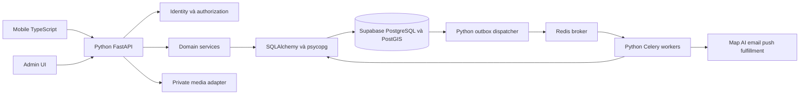

# Thiết kế tích hợp Python và Supabase

**Đã chốt bởi chủ dự án:** backend dùng **Python**, database dùng **Supabase**. **Phương án đề xuất:** FastAPI/Pydantic, SQLAlchemy/psycopg, Celery/Redis và WebSocket Python. Tài liệu chỉ áp dụng cho interface trên trang **backuped (`386:7053`)**; chưa có code runtime, project Supabase hay deployment được tạo trong công việc tài liệu này.

## 1. Trách nhiệm từng lớp

| Thành phần | Sở hữu | Không giao cho thành phần này |
|---|---|---|
| Mobile/admin | UI, form, permissions, cache, request intent | Tính điểm chuẩn, trừ kho, giữ chỗ, quyết định quyền đọc dữ liệu |
| Python API | Auth/ACL, validation, use case, idempotency, API contract | Không giữ HTTP request chờ job AI/fulfillment lâu |
| Supabase PostgreSQL | Facts, ledger, capacity, constraints, locks, outbox | Không coi Data API CRUD là toàn bộ business backend |
| Worker Python | Job chậm, retry, provider calls, projection/cleanup | Không tự sửa balance bỏ qua ledger service |
| Redis | Broker và dữ liệu ephemeral phù hợp | Không là nguồn số dư/tồn kho/lịch sử bền vững |
| Media storage | File và quyền truy cập đã thiết kế | Không lưu file bằng base64 trong bảng PostgreSQL |

Supabase Database là PostgreSQL quản lý; schema logic và transaction đã phân tích vẫn áp dụng. PostGIS dùng cho tìm điểm thu gom/vật liệu/quanh vị trí. [Supabase PostGIS](https://supabase.com/docs/guides/database/extensions/postgis).

## 2. Đường truy cập dữ liệu cơ sở

1. Mobile gửi access token của Identity module tới API Python; API xác minh token/session và quyền object.
2. API thực thi use case qua SQLAlchemy connection có TLS tới Supabase DB bằng **runtime role riêng**.
3. Nghiệp vụ nhiều bảng chạy trong cùng SQL transaction; trả trạng thái canonical cho client.
4. Outbox commit cùng nghiệp vụ, dispatcher giao job; worker có dedup và trả trạng thái vào DB.
5. Mobile không dùng Data API/RPC để tự ghi các bảng điểm/kho/chỗ/session. Các read path cũng đi qua Python trong baseline để giữ một policy surface.

Giao dịch đổi quà không thể được thiết kế như nhiều HTTP CRUD call rời: đọc ví → update ví → update kho → insert lịch sử. Lỗi giữa các call sẽ để lại state không nhất quán. Phương án cơ sở dùng một SQLAlchemy transaction; nếu sau này chọn RPC SQL function thì phải gom nguyên use case, review quyền EXECUTE/search_path và giữ invariant tương đương, không mở lối tắt cho client.

Không giữ DB transaction trong lúc gọi provider. Reserve/commit trước, worker fulfillment sau; provider timeout chưa rõ kết quả đi vào needs_review/reconciliation trước refund hoặc retry.

## 3. Schema, grants, RLS và secret

### Baseline không expose business tables

- Schema ứng dụng: `app_private`; không nằm trong exposed schemas của Data API.
- Thu hồi quyền schema/table/sequence/function không cần thiết của `anon`, `authenticated` và PUBLIC; kiểm cả grants hiện tại lẫn default privileges cho bảng/hàm tạo sau này.
- Role migration sở hữu DDL; role API/worker chỉ được các quyền thực thi cần dùng. Runtime không dùng superuser/owner/BYPASSRLS làm mặc định.
- Bật RLS và policy phù hợp với đường truy cập được phép; với role runtime thường, phải có policy rõ cho các thao tác được cấp. Bảng mới chưa có policy mặc định chưa sẵn sàng cho truy cập.
- API/worker đều phải kiểm business authorization trước query/command. Schema private và role policy không thay kiểm owner ở Python.

Supabase Data API có các lớp grants, exposed schemas và RLS; cần kiểm phối hợp, không dựa vào tên schema “private” để suy ra an toàn. [Securing your API](https://supabase.com/docs/guides/api/securing-your-api).

### JWT và SQL connection là hai ngữ cảnh

Khi API dùng psycopg kết nối DB, user JWT không tự trở thành `auth.uid()` hay user context của RLS. Không ghi policy `auth.uid() = user_id` rồi tuyên bố các truy vấn từ role backend tự được lọc theo user. Baseline authorization theo user nằm trong service; RLS/grants theo role runtime là lớp bổ sung. Nếu cần per-user RLS trên direct SQL, phải thiết kế trusted context theo transaction, reset khi trả connection vào pool, và kiểm thử chống context leak/spoof. [Supabase RLS](https://supabase.com/docs/guides/database/postgres/row-level-security).

Database URL/password, migration credential và privileged Supabase secret/service credential chỉ ở server/CI secret store theo quyền. Không có database credential trong Expo public env, generated client, log hoặc README. Supabase publishable key không phải database password và không cấp quyền business command nếu không có grants/policies; baseline chưa cần phát DB client cho mobile.

## 4. Auth: Python Identity đã chốt

User đã trả lời **“Python tự quản lý tài khoản, mật khẩu và session”**. Vì vậy users/identities/challenges/sessions/refresh_tokens thuộc ứng dụng Python trong `app_private`; không FK `auth.users`, không gọi Supabase Auth và không triển khai luồng login thứ hai.

`contracts/auth-policy.json` pin JWT/password/OTP/refresh security defaults. `contracts/core.openapi.json` pin login/refresh/logout/session read/revoke. JWT access token có sid và phải kiểm active user/session; refresh opaque có hash history để phát hiện token reuse, rotation atomic, mobile single-flight. Role/assignment đọc từ server state. Các operation register/recovery/email change/OAuth còn lại có owner SPEC packet với fixture/error/ACL gates; agent triển khai chúng trong Python, không mở lại lựa chọn Auth provider.

Supabase Storage/Realtime không cần cho baseline database-only. Media/WS có adapter độc lập; không provision dịch vụ khác từ task plan. Nếu có yêu cầu đổi nền tảng sau này phải cập nhật ADR/contracts/migrations rõ ràng, không giữ đồng thời hai kho identity.

## 5. Connection pooling và transaction

API/worker là process lâu dài: thử direct connection hoặc session pooler theo khả năng mạng và giới hạn dự án. Transaction pooler là phương án khác, chỉ dùng khi đã kiểm session features và prepared-statement compatibility của driver. Lấy connection configuration theo project Dashboard/tài liệu hiện hành, không đoán hostname/port/username. [Supabase connections](https://supabase.com/docs/guides/database/connecting-to-postgres).

Các điều kiện phải đo: TLS/certificate, khả năng kết nối từ host Python, pool size/overflow/timeout, số process API/Celery, connection leak khi cancel, và transaction retry/deadlock. Tổng connection của mọi process phải được tính theo gói DB/pooler đã chọn; không mở một DB connection cố định cho từng socket user.

Migration dùng connection phù hợp DDL/session, tách secret khỏi runtime. SQLAlchemy Session theo request hoặc job, rollback khi lỗi và close chắc chắn; không tái dùng Session giữa concurrent tasks. `Session.begin()` bao trọn atomic operation; CPU/network provider work ở ngoài lock. [SQLAlchemy transaction management](https://docs.sqlalchemy.org/en/20/orm/session_transaction.html).

## 6. Một chuỗi migrations

Nguồn chuẩn: `supabase/migrations/*.sql`. Models SQLAlchemy và OpenAPI được cập nhật cùng thay đổi liên quan; không dùng `create_all()` trên production và không chạy Alembic như lịch sử migration thứ hai.

Migration bao gồm schema, bảng, constraints, indexes/PostGIS, grants/RLS, default privileges và functions nếu có. CI dựng lại DB từ empty, upgrade từ previous schema và kiểm drift. Review SQL diff trước apply; không coi mọi diff auto-generated đều an toàn. Chỉ migration ứng dụng được quản lý ở đây; không chỉnh bừa schema nội bộ `auth`/`storage`. [Supabase schema workflow](https://supabase.com/docs/guides/local-development/declarative-database-schemas).

Local Supabase dùng CLI/Docker với dữ liệu tổng hợp; staging và production dùng project riêng. Không đưa migration production vào thao tác chạy test; deploy/migration thật là bước triển khai cần quyền riêng, chưa thực hiện trong task tài liệu.

## 7. Đối chiếu các interface quan trọng

| Interface backuped | Python xử lý | Supabase DB bảo vệ |
|---|---|---|
| Tích điểm/điểm danh | Eligibility, rule version, server date, idempotent command | Unique claim/source, ledger + wallet atomic, không âm ví |
| Xác nhận đổi quà | Giá/stock/eligibility, reserve và fulfillment workflow | Row locks, unique voucher, debit/outbox/idempotency cùng transaction |
| Đăng ký/vé/check-in | Role/age/contact/consent, QR authorization, staff scope | Capacity theo số người, ticket token hash/expiry/used state, anti-replay unique |
| Map/lọc/so sánh | Geo input bounds, all/any vật liệu, freshness và routing provider | PostGIS/GiST, published point/capability/status history |
| Đề xuất/report | Draft ownership, moderation và quyết định publish | FK, review state/version, audit; user report không tự update point |
| Cộng đồng/chat | Visibility/friendship/block/member, signed media access, socket replay | Message sequence/unique client ID, persisted history và source facts |
| Bot/game | Knowledge retrieval, server scoring, quota và anti-cheat | Phiên bản rule, game answer/session uniqueness, award source dedup |

Supabase không thay việc viết các use case này bằng Python. PostgreSQL constraints và transaction là lớp enforcement dữ liệu, không có sẵn luật điểm hoặc đăng ký của BlueSteps.

## 8. Checklist trước triển khai

| Backlog | Kết quả cần có |
|---|---|
| D03 | OpenAPI Python, auth owner rõ, SQL schema và policy surface không có đường command ngoài kiểm soát |
| D04 | Spike pooling/TLS/PostGIS, transaction race, Celery retry và WebSocket replay; ghi compatibility thực tế |
| F01 | Python environment/lock, local Supabase, SQL migrations duy nhất, runtime/migration roles riêng và CI |
| F03 | Python Identity đã chốt; login/refresh/revoke/OTP/OAuth theo packet; không có Supabase Auth path |
| Q02 | Client Data API/RPC/grants không thể tự sửa ledger/kho/chỗ; test cross-user, duplicate command và connection context leak |
| O01 | Chọn gói/region/backup, thử restore database và media riêng, secrets/alerts/runbook và cost model |

Ước lượng 48 task trước đó chưa được tái hiệu chỉnh cho stack mới. Việc chọn Supabase chốt nền tảng database; số ngày còn phụ thuộc team Python, gói dự án, auth/storage decision và kết quả spike. Không tự giảm chức năng hay cam kết rút ngắn thời gian khi chưa có bằng chứng.
