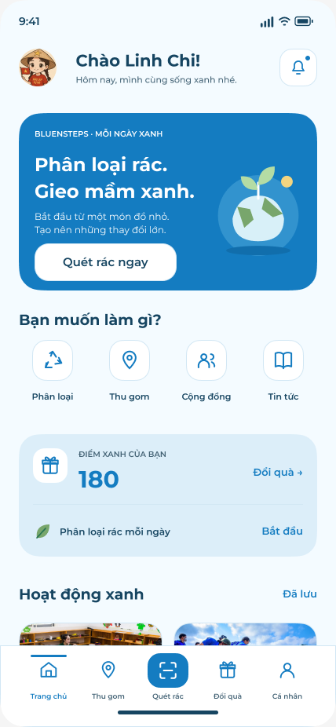

# Báo cáo tiến độ UI BlueSteps — 30/10/2026

## Phiên tiếp tục nhóm Tin tức — 30/10/2026

- Bắt đầu nhóm ưu tiên Tin tức từ catalog, ảnh tìm kiếm/lọc 609:5165 và asset Home đã lưu. Chưa có lần đọc Figma trực tiếp mới.
- Đã dựng lại danh sách dạng grid, tìm kiếm không dấu trong tiêu đề/chủ đề/nội dung, lọc chủ đề và sắp xếp mới nhất/phổ biến, bài đọc có ảnh/metadata và thao tác lưu/thích. Bổ sung `/articles/saved`, `/articles/discussion?id=...`, `/articles/topics`, `/articles/calendar`, `/articles/briefs`.
- Thảo luận có kiểm nội dung, trả lời, thích, sắp xếp và xác nhận xóa bình luận của mình; chủ đề có theo dõi cục bộ; lịch xanh có lọc/ngày/tháng và mở đúng hoạt động; bản tin có chọn ngày và đánh dấu đọc trong màn.
- Đã tách state Tin tức khỏi hoạt động/cộng đồng và nối reset demo; bổ sung bài `daily-waste` để thẻ tin tức Home mở đúng nội dung theo tiêu đề, không lấy bài đầu mảng.
- Chưa nâng số ánh xạ 69/175 hoặc trạng thái nghiệm thu hình ảnh. Bài `daily-waste` dùng ảnh Home gốc; 5 bài khác dùng icon minh họa vì repo thiếu ảnh gốc tương ứng. Các màn mới vẫn ghi đang trong tiến trình, không coi có route là đã nghiệm thu Figma.
- Kiểm chứng cuối phiên: **typecheck, lint, build web, kiểm cấu hình native, 33/33 unit test (15 suite), 46/46 E2E bằng Chrome (2,5 phút)** đạt. Prettier đạt cho code thay đổi; không chạy lại format toàn repo ở phiên Tin tức (vấn đề định dạng cũ giữ trong mục Hoạt động bên dưới).
- Đã sửa cách đổi filter theo tham số route để tránh effect cập nhật state đồng bộ; nút thích/xóa bình luận dùng nhãn theo nội dung, không hiển thị ID dữ liệu. Unit test kiểm reset state Tin tức và tách lưu bài khỏi lưu hoạt động; E2E kiểm cô lập bình luận giữa các bài và các luồng điều hướng.
- Bằng chứng: [log build](ui-progress-evidence-2026-10-30/news-build.log), [log 46 E2E](ui-progress-evidence-2026-10-30/news-e2e.log), [kết quả tổng hợp](ui-progress-evidence-2026-10-30/news-validation.json). Đã lưu và xem ảnh 8 màn/trạng thái (danh sách, lọc, chi tiết, lưu trống, thảo luận, chủ đề, lịch, bản tin), tổng 16 ảnh ở 390/428 px; chưa kiểm thiết bị thật.
- Ví dụ: [Tin tức 390 px](ui-progress-evidence-2026-10-30/news-390.png), [lọc 428 px](ui-progress-evidence-2026-10-30/news-filtered-428.png), [chi tiết 428 px](ui-progress-evidence-2026-10-30/news-detail-428.png), [thảo luận 428 px](ui-progress-evidence-2026-10-30/news-discussion-428.png), [lịch xanh 390 px](ui-progress-evidence-2026-10-30/news-calendar-390.png).

## Phiên triển khai tiếp theo — 30/10/2026

- Tiếp tục từ dữ liệu trong repo theo yêu cầu; chưa đọc được Figma trực tiếp trong phiên này.
- Đã khôi phục dependency bằng `corepack pnpm install --frozen-lockfile` (1.041 gói), không đổi lockfile.
- Đã sửa thẻ Home dùng ID hoạt động rõ ràng: “Giờ học xanh” → `green-class`, thẻ biển → `beach`; bổ sung hoạt động giáo dục theo catalog đã lưu.
- Đã triển khai màn khám phá có thẻ ảnh/tìm tên và địa điểm không dấu/lọc, lịch tháng–tuần và chọn ngày, form đăng ký mở đúng hoạt động, vé/check-in mẫu, tổng kết/phản hồi cục bộ, danh sách lưu có xác nhận xóa, tạo/chuyển/xóa bộ sưu tập và cấu hình nhắc lịch.
- Route mới: `/event-ticket?id=...`, `/event-summary?id=...`, `/event-collections`, `/event-reminders`. Các trạng thái đăng ký/vé/check-in/phản hồi, lưu/bộ sưu tập và nhắc lịch tách riêng; reset demo xóa các thay đổi này.
- Các số liệu 69/175 frame ở phần audit bên dưới vẫn là mốc lịch sử; chưa tăng độ phủ hoặc xác nhận fidelity từ các thay đổi mới.
- Kiểm chứng cuối phiên: typecheck, lint, build web, kiểm cấu hình native, **27/27 unit test (13 suite)** và **40/40 E2E (2,1 phút)** đạt trên source mới. Đã sửa checkbox xuất `aria-checked` trên web và nút về danh sách lưu đóng màn con bằng `dismissTo`.
- Prettier đạt cho toàn bộ file code đã sửa/thêm. `format:check` toàn repo chưa đạt do 187 file cũ ngoài phạm vi sửa (định dạng/xuống dòng trên checkout Windows); giữ nguyên các file đó. Chưa chạy QA thiết bị hoặc bundle native mới trong phiên này.
- Bằng chứng: [log build](ui-progress-evidence-2026-10-30/events-build.log), [log 40 E2E](ui-progress-evidence-2026-10-30/events-e2e.log), [kết quả tổng hợp](ui-progress-evidence-2026-10-30/events-validation.json). Đã lưu 14 ảnh của 7 màn ở 390/428 px và 1 ảnh trạng thái check-in mẫu. Đã xem trực tiếp ảnh khám phá, đăng ký, lịch và vé; các ảnh khác là bằng chứng render, chưa nghiệm thu visual toàn bộ.
- Ví dụ: [khám phá 390 px](ui-progress-evidence-2026-10-30/events-390.png), [đăng ký 428 px](ui-progress-evidence-2026-10-30/event-registration-428.png), [lịch 428 px](ui-progress-evidence-2026-10-30/event-calendar-428.png), [check-in mẫu](ui-progress-evidence-2026-10-30/event-ticket-checked-in-390.png).

**UI đã làm xong ở phạm vi demo:** onboarding, form tài khoản/khôi phục mật khẩu, hồ sơ/thành tích, cài đặt, sổ tay và các màn quét mẫu. **Đang trong tiến trình:** Home, thu gom/hành trình, hoạt động (đã có vé/check-in mẫu, tổng kết, bộ sưu tập và nhắc lịch), điểm/quà, cộng đồng, thông báo, chat, RecycleBot, tin tức (đã có lưu bài, thảo luận, chủ đề, lịch và bản tin), trò chơi và thống kê. **Chưa làm:** giọng nói, các bước đính kèm ảnh/quyền riêng tư của bài cộng đồng và các luồng thưởng chi tiết được liệt kê bên dưới.

Cập nhật này phân loại theo **chức năng và phạm vi UI đã triển khai**, không lấy số frame ánh xạ làm trạng thái hoàn thành chức năng. Theo lần kiểm kê Figma trực tiếp ngày 30/10, **69/175 frame có ánh xạ code (39,4%)**, còn 106 frame chưa có ánh xạ riêng. Trong 106 frame này có cả phần đã có UI demo và phần chưa làm; không gọi toàn bộ là “chưa làm”. Chưa đọc lại Figma trong lần sửa cách trình bày báo cáo này.

69 frame đều còn trạng thái chờ đối chiếu hình ảnh đầy đủ; chưa có cơ sở xác nhận toàn bộ giao diện khớp Figma 100%. Tỷ lệ 39,4% đo số frame có code theo thiết kế, **không phải phần trăm hoàn thành sản phẩm hoặc khối lượng công việc**. Frame bao gồm màn hình, biến thể, overlay và khung phụ, có độ phức tạp khác nhau.

## Trạng thái UI theo chức năng

Quy ước áp dụng cho các bảng bên dưới:

- **Đã làm xong UI:** đã dựng đủ màn, nội dung và tương tác cục bộ cho phạm vi demo nêu trong dòng đó; không còn thiếu màn chính trong phạm vi này. Việc nghiệm thu độ khớp Figma và thiết bị vẫn có thể đang chờ.
- **Đang trong tiến trình:** đã có UI hoặc tương tác nhưng còn thiếu màn, trạng thái, bố cục theo Figma hoặc còn lỗi điều hướng. Đây là trạng thái triển khai dở dang, không khẳng định có người đang code chức năng đó ngay lúc đọc báo cáo.
- **Chưa làm:** chưa thấy màn/overlay hoặc luồng UI tương ứng trong code đã kiểm tra. Nút liên kết, thông báo “chưa bật” hoặc một màn demo gần giống không được tính là đã làm chức năng đó.

Các trạng thái này chỉ nói về UI. Backend, xác thực thật, phát điểm, giao dịch, push và realtime được ghi riêng, không dùng việc chưa nối backend để tự động đổi một UI đã dựng đủ thành “chưa làm”.

### UI đã làm xong trong phạm vi demo

| Chức năng | Trạng thái | UI đã hoàn thành | Màn/code đối chiếu và giới hạn |
|---|---|---|---|
| Onboarding và cá nhân hóa ban đầu | **Đã làm xong UI** | 10 bước: khởi động, chào mừng, Reduce/Reuse/Recycle, sở thích, mục tiêu, giới thiệu vị trí, nhắc nhở, sẵn sàng | `/onboarding` — [OnboardingScreen.tsx](../apps/mobile/src/features/auth/OnboardingScreen.tsx); lựa chọn trong phiên demo |
| Đăng nhập và đăng ký tài khoản | **Đã làm xong UI** | Hai form, kiểm tra dữ liệu, hiện/ẩn mật khẩu, thông báo và điều hướng | `/login`, `/register` — [AuthForm.tsx](../apps/mobile/src/features/auth/AuthForm.tsx); chưa cấp tài khoản/session thật |
| Khôi phục mật khẩu | **Đã làm xong UI** | Nhập email, xác thực OTP sáu số, đặt mật khẩu mới và kiểm tra xác nhận mật khẩu | `/forgot-password`, `/verify-email`, `/reset-password` — [RecoveryScreens.tsx](../apps/mobile/src/features/auth/RecoveryScreens.tsx); chưa gửi OTP/reset thật |
| Hoàn tất tài khoản Google/Facebook | **Đã làm xong UI** | Màn thông tin nhà cung cấp, tên, đồng ý và xác nhận mẫu | `/connected-account` — [ConnectedAccountScreen.tsx](../apps/mobile/src/features/auth/ConnectedAccountScreen.tsx); chưa có luồng OAuth thật |
| Hồ sơ cá nhân và chỉnh sửa hồ sơ | **Đã làm xong UI** | Tổng quan hồ sơ, các lối tắt, form chỉnh sửa và kiểm tra dữ liệu | `/profile`, `/edit-profile` — [ProfileOverview.tsx](../apps/mobile/src/features/profile/ProfileOverview.tsx), [EditProfileScreen.tsx](../apps/mobile/src/features/profile/EditProfileScreen.tsx); chưa lưu hồ sơ lên server |
| Thành tích | **Đã làm xong UI** | Màn thành tích/huy hiệu và dữ liệu trình diễn | `/achievements` — [AchievementsScreen.tsx](../apps/mobile/src/features/profile/AchievementsScreen.tsx); thành tích mẫu |
| Cài đặt và các bảng tùy chọn | **Đã làm xong UI** | Trang cài đặt, tìm kiếm, âm thanh/rung, lịch sử đăng nhập và bàn phím PIN sáu số | `/settings` và bốn overlay — [SettingsScreen.tsx](../apps/mobile/src/features/profile/SettingsScreen.tsx), [SettingsOverlay.tsx](../apps/mobile/src/features/profile/SettingsOverlay.tsx); PIN và lịch sử là bản xem trước |
| Đổi mật khẩu | **Đã làm xong UI** | Form, hiện/ẩn mật khẩu, kiểm tra và phản hồi mẫu | `/change-password` — [ChangePasswordScreen.tsx](../apps/mobile/src/features/auth/ChangePasswordScreen.tsx); chưa thay đổi thông tin đăng nhập thật |
| Tra cứu sổ tay và danh mục rác | **Đã làm xong UI** | Trang đầu, biến thể chọn, danh sách/tìm kiếm, ba danh mục và ba hướng dẫn mở rộng | `/handbook`, `/handbook/list`, `/handbook/category/...` — [thư mục handbook](../apps/mobile/src/features/handbook); hỗ trợ tìm tiếng Việt không dấu và đóng overlay |
| Hướng dẫn vật liệu và bảng phân loại | **Đã làm xong UI** | Bảy hướng dẫn vật liệu; bốn bảng nhựa, y tế, túi nilon, pin; CTA và điều hướng liên quan | `/handbook/[id]`, `/handbook/types/[kind]` — [HandbookGuide.tsx](../apps/mobile/src/features/handbook/HandbookGuide.tsx), [HandbookTypesScreen.tsx](../apps/mobile/src/features/handbook/HandbookTypesScreen.tsx); typography/emoji còn chờ nghiệm thu hình ảnh |
| Quét rác — camera/chọn ảnh và các trạng thái demo | **Đã làm xong UI** | Xin quyền, chụp/chọn ảnh, nhập tay; 10 trạng thái mẫu gồm loading, không nhận diện, kết quả, chi tiết, thành công/điểm mẫu và sổ tay từ quét | `/scan` — [thư mục scan](../apps/mobile/src/features/scan); chưa nhận diện ảnh thật, chưa phát điểm; camera/picker trên thiết bị cần QA chi tiết |
| Đề xuất điểm thu gom và báo cáo vấn đề | **Đã làm xong UI** | Hai form, chọn ảnh cục bộ, kiểm tra trường, chọn loại vấn đề và lưu nháp trong phiên | `/point-proposal`, `/point-report` — [CollectionProposalScreen.tsx](../apps/mobile/src/features/collection/CollectionProposalScreen.tsx), [CollectionReportScreen.tsx](../apps/mobile/src/features/collection/CollectionReportScreen.tsx); chưa gửi tới đơn vị thu gom |

### UI đang trong tiến trình

| Chức năng | Trạng thái | Phần UI đã có | Phần UI còn phải làm/sửa |
|---|---|---|---|
| Trang chủ | **Đang trong tiến trình** | Header, banner, lối tắt, ví điểm, thẻ hoạt động/sổ tay/tin tức, năm tab; thẻ lớp học/biển mở đúng ID, thẻ tin tức mở `daily-waste` khớp tiêu đề và ảnh | Còn nghiệm thu hình ảnh Home. [HomeScreen.tsx](../apps/mobile/src/features/home/HomeScreen.tsx) |
| Tìm và xem điểm thu gom | **Đang trong tiến trình** | Bản đồ mẫu, khám phá, tìm kiếm/lọc, so sánh và chi tiết điểm; nhóm có 7/10 frame ánh xạ | Bổ sung/đối chiếu ba biến thể điểm thu gom còn lại; kiểm tra bản đồ và các trạng thái trên thiết bị. [Thư mục collection](../apps/mobile/src/features/collection) |
| Lập hành trình và bàn giao | **Đang trong tiến trình** | Thêm/bỏ/đổi thứ tự điểm, chọn tuyến/chặng, chỉ đường mẫu, thay điểm, hướng dẫn bàn giao; 6/9 frame ánh xạ | Ba biến thể hành trình còn lại và đối chiếu đầy đủ UI; chưa có map/GPS thật |
| Khám phá và xem chi tiết hoạt động | **Đang trong tiến trình** | Thẻ ảnh từ asset Home cho lớp học/biển; tìm tên và địa điểm không dấu; lọc TP HCM/cuối tuần/Dọn rác/Trồng cây/Phân loại; chi tiết, lưu và lối vào đăng ký/vé/tổng kết | Còn ảnh gốc cho các hoạt động khác (đang dùng icon), thanh điều hướng và biến thể chi tiết theo Figma. [EventScreens.tsx](../apps/mobile/src/features/events/EventScreens.tsx) |
| Lịch hoạt động | **Đang trong tiến trình** | Lịch tháng/tuần, chuyển tháng qua năm, chọn ngày bằng ngày ISO đầy đủ, dấu hoạt động, lọc đăng ký mẫu và trạng thái trống | Còn đối chiếu bố cục/biến thể frame 534:49166; thời gian hiển thị theo lịch mẫu Việt Nam |
| Đăng ký tham gia hoạt động | **Đang trong tiến trình** | Tóm tắt đúng hoạt động; tên/điện thoại/email; tăng giảm số người 1–5, chọn vai trò, hai mục đồng ý; kiểm dữ liệu và mở vé mẫu trong phiên | Còn đối chiếu typography, dropdown vai trò và khoảng cách theo ảnh 534:49326. Không giữ chỗ/gửi đăng ký thật. [EventParticipationScreens.tsx](../apps/mobile/src/features/events/EventParticipationScreens.tsx) |
| Vé tham gia và check-in hoạt động | **Đang trong tiến trình** | `/event-ticket?id=...`: người tham gia, số người/vai trò, lịch/địa điểm, ký hiệu QR và mã DEMO, sao chép thông tin, check-in cục bộ; có trạng thái chưa đăng ký | Còn asset và đối chiếu hình ảnh 534:49416; ký hiệu QR không có payload, chưa lưu ảnh vé hoặc check-in thật |
| Tổng kết sau hoạt động | **Đang trong tiến trình** | `/event-summary?id=...`: tổng kết bằng số liệu minh họa, chọn 1–5 sao, nhãn đánh giá và ghi chú; lưu phản hồi vào đăng ký mẫu | Còn phần dấu ấn cá nhân/ảnh và đối chiếu frame 534:49760; không xác nhận tham gia, hoàn thành hoặc phát thưởng |
| Hoạt động đã lưu | **Đang trong tiến trình** | Tìm kiếm, lưu/bỏ lưu; xác nhận/hủy xóa, phản hồi sau xóa; lối vào bộ sưu tập/nhắc lịch; xóa đồng bộ khỏi bộ sưu tập và lời nhắc nhưng giữ vé mẫu | Còn đối chiếu các biến thể yêu thích theo Figma. [SavedEventScreens.tsx](../apps/mobile/src/features/events/SavedEventScreens.tsx) |
| Quản lý bộ sưu tập hoạt động yêu thích | **Đang trong tiến trình** | `/event-collections`: tạo/chọn bộ sưu tập; chọn và thêm/chuyển/bỏ hoạt động; đếm đúng dữ liệu; xác nhận xóa bộ sưu tập, giữ danh sách lưu/vé/nhắc lịch | Còn bố cục/thẻ và thao tác theo ảnh gốc 534:49845; dữ liệu trong RAM |
| Cấu hình nhắc lịch hoạt động đã lưu | **Đang trong tiến trình** | `/event-reminders`: bật/tắt, chọn hoạt động, mốc 1h/3h/1 ngày/tùy chỉnh 1–168h, chọn thông báo/email, giờ yên lặng và kiểm HH:mm; lưu nháp khi xác nhận | Còn đối chiếu frame 534:49968 và QA bàn phím trên thiết bị; mới lưu cấu hình, chưa hẹn/gửi/dời lời nhắc |
| Ví điểm, danh mục/chi tiết quà và lịch sử | **Đang trong tiến trình** | Ví điểm mẫu, danh mục có lọc, chi tiết, kiểm số dư minh họa và lịch sử seed | Bố cục/biến thể từng loại quà, UI xác nhận/kết quả đổi quà, nhận thưởng ngày và nhắc thưởng; nhóm 17 frame mới ánh xạ màn Thành tích. [RewardScreens.tsx](../apps/mobile/src/features/rewards/RewardScreens.tsx) |
| Cộng đồng và soạn bài | **Đang trong tiến trình** | Feed, thích/bỏ thích, bài viết văn bản cục bộ và danh sách bình luận mẫu | UI ảnh/quyền riêng tư, các biến thể composer, trạng thái đăng bài và tương tác bình luận đầy đủ. [CommunityScreens.tsx](../apps/mobile/src/features/community/CommunityScreens.tsx) |
| Thông báo | **Đang trong tiến trình** | Danh sách seed, chưa đọc/đã đọc, đánh dấu và mở nội dung | Các loại/tab/biến thể thông báo theo bảy frame Figma. [ContentScreens.tsx](../apps/mobile/src/features/content/ContentScreens.tsx) |
| Tin nhắn cá nhân | **Đang trong tiến trình** | Danh sách hội thoại, xem/gửi chữ trong phiên | Bố cục và trạng thái chat theo bốn frame; chưa có trao đổi tin thật. [MessageScreens.tsx](../apps/mobile/src/features/messages/MessageScreens.tsx) |
| RecycleBot — hội thoại chữ | **Đang trong tiến trình** | Màn chat với câu trả lời cố định có nhãn demo | Các biến thể màn bot, trạng thái phản hồi và giọng nói theo Figma; chưa có AI thật |
| Tin tức — danh sách, tìm kiếm và chi tiết | **Đang trong tiến trình** | Grid 2 cột; tìm tiêu đề/chủ đề/nội dung không dấu; lọc 4 chủ đề, sắp mới nhất/phổ biến; chi tiết có metadata, lưu/thích, thảo luận và bài liên quan; bài Home có ảnh gốc | Còn ảnh gốc của 5 bài demo khác, nội dung/bố cục từng biến thể bài đọc, hero/carousel/thanh điều hướng theo thiết kế. [NewsScreens.tsx](../apps/mobile/src/features/content/NewsScreens.tsx) |
| Tin tức — bài viết đã lưu | **Đang trong tiến trình** | `/articles/saved`: grid, tìm kiếm/lọc/sắp xếp; xác nhận/hủy bỏ lưu và trạng thái trống; state tách khỏi `/saved` hoạt động | Còn đối chiếu bố cục/asset gốc 609:5266; chưa lưu bền vững |
| Tin tức — thảo luận bài viết | **Đang trong tiến trình** | `/articles/discussion?id=...`: bình luận gắn đúng bài, kiểm nội dung 1–500 ký tự, trả lời, thích, sắp xếp, xác nhận xóa bình luận của mình và trạng thái trống | Còn đối chiếu frame 609:5361, avatar/biến thể thiết kế và QA bàn phím native. [NewsDiscussionScreen.tsx](../apps/mobile/src/features/content/NewsDiscussionScreen.tsx) |
| Tin tức — khám phá chủ đề | **Đang trong tiến trình** | `/articles/topics`: 4 chủ đề, số bài, theo dõi/bỏ theo dõi cục bộ, mở feed đúng bộ lọc và đổi chủ đề qua điều hướng | Còn ảnh/bố cục chính xác 612:5286; chưa cá nhân hóa hoặc gửi tin từ chủ đề |
| Tin tức — lịch sự kiện xanh | **Đang trong tiến trình** | `/articles/calendar`: màn riêng trong Tin tức, lịch ngày/tháng, dấu sự kiện, lọc danh mục, trạng thái trống, mở đúng hoạt động và bài đọc liên quan | Còn đối chiếu frame 612:5362; dùng lại dữ liệu mẫu hoạt động, chưa có lịch biên tập thật |
| Tin tức — bản tin nhanh | **Đang trong tiến trình** | `/articles/briefs`: tóm tắt bài theo ngày, chọn ngày/tất cả, đánh dấu đã đọc/chưa đọc trong màn, đọc toàn bài và phục hồi empty | Còn đối chiếu frame 612:5441; chưa có bản tin biên tập/API. [NewsExploreScreens.tsx](../apps/mobile/src/features/content/NewsExploreScreens.tsx) |
| Trò chơi phân loại | **Đang trong tiến trình** | Bài luyện chạm ba câu, phản hồi và chơi lại | Các màn/luồng trò chơi theo 10 frame Figma. [GameScreen.tsx](../apps/mobile/src/features/games/GameScreen.tsx) |
| Thống kê cá nhân | **Đang trong tiến trình** | Tổng quan và bảng số liệu tuần giả lập | Bố cục/biểu diễn thống kê theo frame 391:25009 và nghiệm thu UI. [ProfileScreens.tsx](../apps/mobile/src/features/profile/ProfileScreens.tsx) |

### UI chưa làm

| Chức năng cụ thể | Trạng thái | Phạm vi UI chưa có | Tham chiếu Figma |
|---|---|---|---|
| Nhận thưởng ngày và nhắc thưởng | **Chưa làm UI** | Các màn nhận thưởng ngày, sau nhận thưởng và đặt nhắc thưởng; ví hiện tại chỉ ghi chức năng chưa bật | 386:12671, 386:11652, 386:11858 |
| Hướng dẫn quy đổi điểm | **Chưa làm UI** | Màn hướng dẫn/cách quy đổi riêng | 386:11320 |
| Xác nhận và kết quả đổi quà theo thiết kế | **Chưa làm UI** | Hai màn/biến thể xác nhận và sau xác nhận; nút kiểm số dư và nút đổi quà bị khóa hiện tại chưa phải luồng này | 386:12517, 386:12362 |
| Đính kèm ảnh, chọn quyền riêng tư và trạng thái tải khi đăng bài | **Chưa làm UI** | Các bước UI tương ứng trong bộ composer; hiện mới nhập và thêm văn bản cục bộ | Bộ 386:15047–386:16071 và 386:16188 |
| RecycleBot — giọng nói | **Chưa làm UI** | Màn/trạng thái ghi âm, nghe và xử lý giọng nói theo bộ frame bot | Nhóm RecycleBot & giọng nói trong catalog |

Các dòng “chưa làm” là phần con của một số nhóm đang trong tiến trình, vì vậy không cộng số dòng các bảng thành số tính năng hoặc số frame. Hai frame tư liệu/khung phụ và frame navigation rời cần xác định vai trò trước khi quy thành chức năng sản phẩm.

**Nghiệm thu UI:** các màn ghi “đã làm xong UI” mới hoàn tất triển khai demo; toàn bộ nhóm vẫn cần chốt độ khớp Figma và QA thiết bị. Sai khác typography/emoji đã biết được giữ ở mục lỗi bên dưới, không bị bỏ qua khi đổi cách ghi trạng thái.

## Phạm vi và cách kiểm tra

- Nguồn thiết kế: [Figma — trang backuped, 386:7053](https://www.figma.com/design/7GCLABwia0mauoszRi0Vtt/Untitled?node-id=386-7053). Báo cáo chỉ xét trang này; chưa kiểm kê các page Figma khác.
- Đã đọc trực tiếp cấu trúc Figma ngày 30/10: **186 đối tượng cấp cao, gồm 175 FRAME**. Snapshot 29/10 trong repo có 180 đối tượng/169 frame. Không phát hiện frame cũ bị xóa khỏi tập ID; có 6 frame Tin tức mới.
- Đối chiếu ID với `fidelity-targets.cjs`, `coverage.json`, route và file nguồn thực tế. Cả 69 ánh xạ đều có source tồn tại. Mốc audit có 54 file route ngoài `_layout`; phiên Hoạt động thêm 4 và phiên Tin tức thêm 5 route, thành 63. Số route không tương đương số màn độc lập vì nhiều trạng thái dùng chung route.
- Đã lấy và xem ảnh Figma mới của Home, Khám phá hoạt động và Tìm kiếm tin tức; xem Home và chi tiết hoạt động trên bản export web hiện có ở viewport 428 × 926.
- Đã kiểm tra code các nhóm chức năng và chạy lại build, kiểm tra kiểu, unit test và E2E. Giới hạn của từng kết quả nằm ở mục kiểm chứng.

Bằng chứng kiểm kê: [cấu trúc Figma đọc trực tiếp](ui-progress-evidence-2026-10-30/figma-live-inventory.json), [audit từng frame dạng JSON](ui-progress-evidence-2026-10-30/frame-audit.json), [bảng 175 frame CSV](ui-progress-evidence-2026-10-30/frame-audit.csv). Có thể dựng lại bảng từ dữ liệu đã lưu bằng `node docs/ui-progress-evidence-2026-10-30/build-inventory.cjs`.

## Phụ lục độ phủ frame theo nhóm UI

“Đã ánh xạ” là có frame Figma, route và source triển khai riêng trong bộ fidelity; chưa bao hàm nghiệm thu hình ảnh. “Còn lại” có thể đã có trang demo chức năng nhưng chưa được ghi nhận là triển khai theo frame tương ứng.

| Nhóm theo catalog | Frame hiện tại | Đã ánh xạ | Còn lại | Nhận xét |
|---|---:|---:|---:|---|
| Onboarding & cá nhân hóa | 10 | 10 | 0 | Đủ các bước giới thiệu/chọn sở thích/mục tiêu ở mức UI |
| Tài khoản & xác thực | 6 | 6 | 0 | Đăng nhập, đăng ký, khôi phục, OTP, mật khẩu mới, kết nối tài khoản; xác thực còn demo |
| Hồ sơ | 2 | 2 | 0 | Cá nhân và chỉnh sửa hồ sơ đã dựng |
| Cài đặt & bảo mật | 6 | 6 | 0 | Trang cài đặt, bốn overlay và đổi mật khẩu; chưa có bảo mật tài khoản thật |
| Sổ tay & kiến thức rác | 21 | 21 | 0 | Landing, danh sách, danh mục/overlay, bảy hướng dẫn và bốn bảng phân loại |
| Camera & nhận diện | 9 | 9 | 0 | Đã dựng các trạng thái Figma; chưa có API nhận diện |
| Điều hướng dùng chung | 2 | 1 | 1 | Catalog xếp Home ở nhóm này; các thanh điều hướng lồng trong màn không đếm riêng |
| Điểm thu gom | 10 | 7 | 3 | Bản đồ mẫu, khám phá, lọc, so sánh, chi tiết, đề xuất, báo cáo |
| Hành trình & bàn giao | 9 | 6 | 3 | Hành trình, tuyến/chặng, chỉ đường mẫu, thay điểm, bàn giao |
| Hoạt động & tham gia | 13 | 0 | 13 | Đã mở rộng khám phá/lịch/form, thêm vé/check-in/tổng kết mẫu; chưa bổ sung ánh xạ fidelity từng frame |
| Hoạt động đã lưu & nhắc lịch | 5 | 0 | 5 | Đã có bộ sưu tập, xác nhận xóa và cấu hình nhắc lịch; còn đối chiếu hình ảnh và ánh xạ fidelity |
| Điểm, đổi quà & thành tích | 17 | 1 | 16 | Thành tích đã ánh xạ; ví, quà và lịch sử còn giao diện demo |
| Cộng đồng & tạo bài | 12 | 0 | 12 | Có feed, thích và composer cục bộ; thiếu các biến thể theo Figma |
| Thông báo | 7 | 0 | 7 | Có inbox/đã đọc demo; chưa dựng từng frame thông báo |
| Tin nhắn cá nhân | 4 | 0 | 4 | Danh sách hội thoại và gửi tin cục bộ; chưa đối chiếu frame |
| RecycleBot & giọng nói | 11 | 0 | 11 | Bot trả lời cố định; thiếu UI đầy đủ và các trạng thái giọng nói |
| Tin tức | 18 | 0 | 18 | Đã có grid/lọc/chi tiết/lưu/thảo luận/chủ đề/lịch/bản tin demo; chưa ánh xạ và nghiệm thu từng frame |
| Trò chơi | 10 | 0 | 10 | Mới có bài luyện phân loại ba câu, chưa tương đương luồng Figma |
| Thống kê | 1 | 0 | 1 | Có số liệu tuần giả lập; chưa đối chiếu frame |
| Tư liệu/khung phụ | 2 | 0 | 2 | Cần phân loại có thuộc đầu ra sản phẩm hay chỉ là tư liệu |
| **Tổng** | **175** | **69** | **106** | **39,4% độ phủ frame** |

Luồng quét thực tế có 10 frame đã ánh xạ; frame “Sổ tay rác_Scan” (386:14454) nằm ở nhóm “Sổ tay & kiến thức rác” của catalog gốc. Bảng giữ nguyên cách nhóm của catalog để truy vết, tránh đếm hai lần.

## Sáu frame mới cần bổ sung vào kế hoạch

| Node Figma | Tên | Kích thước |
|---|---|---|
| 609:5165 | Tin tức · Tìm kiếm và lọc | 428 × 926 |
| 609:5266 | Tin tức · Bài viết đã lưu | 428 × 926 |
| 609:5361 | Tin tức · Thảo luận bài viết | 428 × 926 |
| 612:5286 | Tin tức · Khám phá chủ đề | 428 × 926 |
| 612:5362 | Tin tức · Lịch sự kiện xanh | 428 × 926 |
| 612:5441 | Tin tức · Bản tin nhanh | 428 × 926 |

Trang `/articles` đã có grid, tìm kiếm không dấu, lọc chủ đề và sắp xếp theo dữ liệu mẫu. Năm route Tin tức mới đã dựng riêng: `/articles/saved`, `/articles/discussion`, `/articles/topics`, `/articles/calendar`, `/articles/briefs`; `/discussion` cộng đồng và `/calendar` hoạt động vẫn giữ ý nghĩa riêng. Repo mới có ảnh tham chiếu màn tìm kiếm 609:5165 và tên/kích thước của năm frame mới còn lại, nên các màn mới chưa được coi là triển khai khớp từng frame.

## Kết quả đối chiếu và lỗi cần sửa

1. **P1 — Home mở sai nội dung hoạt động: đã sửa trong phiên triển khai này.** Thẻ lớp học dùng `green-class`, thẻ biển dùng `beach`, không còn lấy đích theo vị trí mảng. E2E mới đã đi từ Home tới đúng tiêu đề/địa điểm và form của lớp học.
2. **P1 — Các nhóm demo chưa giữ bố cục Figma.** Nhóm Hoạt động đã thay thẻ ngày bằng thẻ ảnh/icon, thêm các bộ lọc và luồng mới. Tin tức đã có grid 2 cột, tìm kiếm/lọc/sắp xếp và các màn con; còn thiếu ảnh gốc, hero/carousel, thanh điều hướng, biến thể và đối chiếu chi tiết. Không coi grid dùng icon thay ảnh là đã hoàn tất fidelity.
3. **P2 — Typography và chi tiết hình ảnh còn sai khác.** Home quan sát có bố cục chính/asset/header/navigation gần ảnh mới; chưa khẳng định khớp từng pixel. Bộ đối chiếu đã lưu ghi nhận khác biệt font/emoji/xuống dòng, đặc biệt hướng dẫn vật liệu và chi tiết quét. [Báo cáo diff đã lưu](figma-fidelity/diff/report.json) có sai khác khác 0; không chuyển các số đo này thành “% giống Figma”.
4. **P2 — Tài liệu độ phủ đang dùng snapshot cũ.** `figma-fidelity/coverage.json` vẫn ghi 69/169 và blocked do quyền. Lần này đọc được cấu trúc lẫn ảnh mới, nên lỗi đọc trước đây không chặn cuộc kiểm tra này. Bản báo cáo giữ nguyên artifact lịch sử, đưa kiểm kê 175 frame vào thư mục bằng chứng riêng; không suy ra kết nối sẽ ổn định cho mọi frame/lần gọi sau.
5. **P2 — Chưa nghiệm thu UI native đầy đủ.** Tài liệu Expo Go đã ghi nhận mở app trên iPhone/Android trong phiên trước. Phiên mở demo tiếp theo đã dựng lại bundle iOS/Android thành công, nhưng chưa có kết quả QA chi tiết camera, quyền ảnh, keyboard, safe area, cỡ chữ lớn và từng luồng trên thiết bị thật.

### Ảnh tham chiếu mới

Home Figma đọc ngày 30/10:

Đối chiếu với [ảnh Home đã lưu của ứng dụng](figma-fidelity/rendered/home-428.png). Home cũng đã được mở và xem lại trực tiếp trong lần audit này; ảnh local ở liên kết là bằng chứng capture trước đó.

Tham chiếu cho phần chưa dựng đủ: [Khám phá hoạt động](ui-progress-evidence-2026-10-30/figma-534-49034.png), [Tin tức — tìm kiếm và lọc](ui-progress-evidence-2026-10-30/figma-609-5165.png).

## Kiểm chứng lịch sử trước phiên triển khai tiếp theo

**Kết quả hiện tại xem ở đầu báo cáo.** Các lỗi dependency và kết quả bên dưới thuộc lần audit trước; sau cài dependency trong phiên tiếp theo, build/typecheck/unit test đã chạy đạt và E2E đạt 40/40 trên bản export mới.

Các lệnh build/typecheck/unit test bên dưới được chạy ở lần audit đầu ngày 30/10. Sau đó, khi mở QR demo, dependency đã được cài lại thành công theo lockfile và Metro/tunnel đã chạy được. Khi kiểm tra lại trước lần push GitHub đầu tiên, cả ba lệnh tiếp tục báo các lỗi dependency tương ứng trong môi trường chạy lệnh hiện tại. Vì vậy Metro đã chạy thành công nhưng chưa thể đánh dấu build web, typecheck hoặc unit test là đạt.

| Kiểm tra | Kết quả lần audit này | Ý nghĩa |
|---|---|---|
| Figma trực tiếp | Đọc được trang và ba ảnh đại diện | Có thể lập báo cáo với phạm vi mới; chưa xem hình ảnh từng frame |
| Ánh xạ/source | 69 ánh xạ, không thiếu file nguồn | Xác nhận có code, chưa xác nhận fidelity |
| Bằng chứng hình ảnh lịch sử | 69 frame có ảnh tham chiếu và ảnh ứng dụng theo coverage; 65 có context local | Phạm vi bằng chứng đã lưu, không phải 69 frame nghiệm thu |
| Preview web đã export | Mở được Home và chi tiết hoạt động ở lần audit đầu | Kiểm tra bản export có sẵn; lần export web trước push chưa thành công |
| `pnpm build` | Audit đầu và lần chạy trước push đều lỗi `exports is not defined in ES module scope` tại `glob` | Chưa xác nhận build web mới đạt |
| `pnpm typecheck` | Audit đầu và lần chạy trước push đều thiếu thư viện TypeScript và type definitions Node/React | Chưa xác nhận kiểm tra kiểu đạt |
| `pnpm test` | Audit đầu và lần chạy trước push đều không khởi động được Jest do thiếu `y18n` | Chưa có kết quả unit test mới đạt |
| `pnpm test:e2e` | **36/36 đạt, 1,9 phút**, khi dùng Chrome cài sẵn | Xác nhận các hành vi được test trên bản export hiện có; không thay xác minh build mới |
| Khôi phục dependency | `pnpm install --frozen-lockfile` hoàn tất với 1.041 gói | Môi trường đã mở được Metro; không đổi phiên bản trong lockfile |
| Expo Go demo SDK 58 | Tunnel/manifest HTTP 200; bundle iOS 9.423.522 byte và Android 10.087.872 byte đều HTTP 200 | Đã tạo QR mới cho người dùng; xác nhận khả năng phân phối demo, chưa xác nhận người dùng đã quét/mở phiên mới |
| Native/device QA chi tiết | Chưa có kết quả QA mới cho từng luồng | Cần kiểm camera/picker, keyboard, safe area và layout thực tế |

Lần chạy E2E mặc định thiếu Chromium của Playwright nên dừng ở bước mở browser; đã chạy lại bằng `PLAYWRIGHT_CHROMIUM_EXECUTABLE=C:\Program Files\Google\Chrome\Application\chrome.exe`. Không coi lỗi launcher ban đầu là 36 lỗi nghiệp vụ. [Log E2E lần chạy bằng Chrome](ui-progress-evidence-2026-10-30/e2e-current.log).

README fidelity trước đây ghi 36/36 E2E và 20/20 kiểm tra chức năng đạt. Ở lần audit trước, E2E đã được chạy lại như bảng trên; 20/20 unit test lúc đó là kết quả lịch sử. Bằng chứng mở demo ở lần audit: [thông tin phiên Expo Go](frontend-evidence/expo-go-current-session.json). Lần audit đó không sửa UI sản phẩm và không tự nâng trạng thái nghiệm thu từ việc tunnel chạy được; các thay đổi UI tiếp theo và kết quả 27 unit/40 E2E nằm ở đầu báo cáo.

## Việc ưu tiên tiếp theo

| Thứ tự | Công việc | Điều kiện hoàn thành |
|---|---|---|
| 1 | Đã sửa liên kết hoạt động từ Home; tiếp tục giữ kiểm tra hồi quy | Đã mở đúng lớp học và biển; typecheck/build/unit test đã chạy đạt trên source mới |
| 2 | Hoàn thiện fidelity nhóm Hoạt động và hoạt động đã lưu/nhắc lịch (18 frame) | Các màn/luồng demo đã có; còn asset, dropdown vai trò, dấu ấn cá nhân, thanh điều hướng, biến thể, ánh xạ và đối chiếu ảnh theo từng frame |
| 3 | Hoàn thiện fidelity Tin tức (18 frame, gồm 6 frame mới) | Các luồng demo đã dựng; còn ảnh gốc, hero/carousel/thanh điều hướng, nội dung/bố cục chi tiết, biến thể, ánh xạ và đối chiếu ảnh |
| 4 | Hoàn thiện 6 frame thu gom/hành trình còn lại và 16 frame điểm/quà còn lại | Đủ biến thể/overlay, điều hướng đúng và capture ở hai chiều rộng |
| 5 | Dựng cộng đồng, thông báo, chat, bot, game và thống kê | Đủ frame từng nhóm; không dùng một màn demo để đại diện cho cả nhóm |
| 6 | Nghiệm thu hình ảnh và thiết bị | Đối chiếu typography/asset/spacing/scroll/overlay, kiểm iOS/Android và các trạng thái lỗi/trống/tải |

Xác thực thật, lưu dữ liệu bền vững, nhận diện ảnh, bản đồ/GPS, phát điểm/đổi quà, vé/check-in, push và realtime chưa tích hợp. Các thiếu hụt này được ghi để phân biệt UI demo với sản phẩm chạy thật; không dùng để phủ nhận những frame UI đã dựng.
